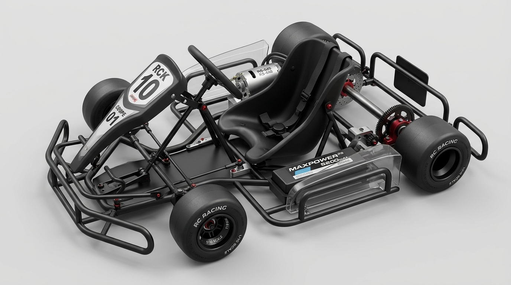
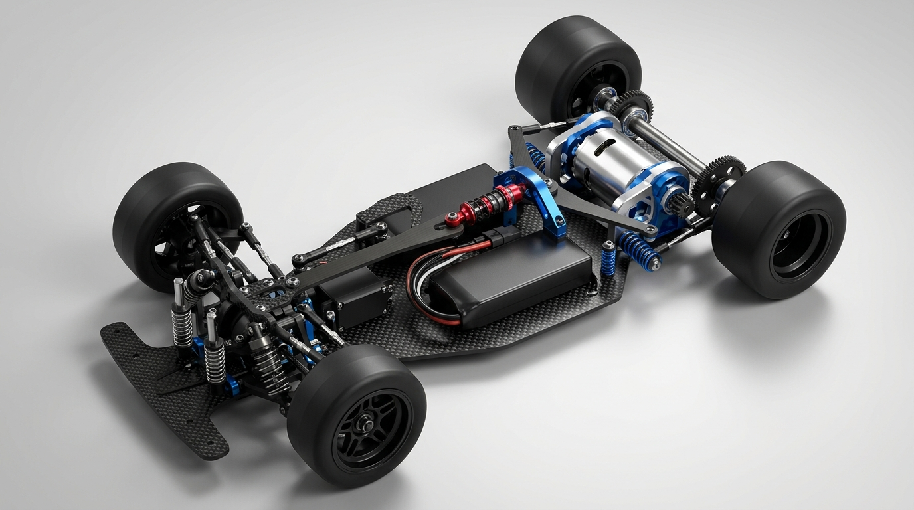
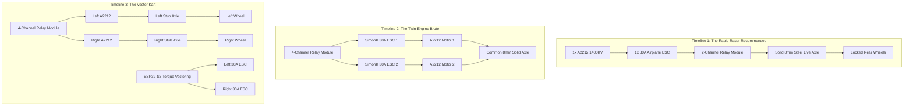

# 🏎️ Scratch-Built 1/10 RWD RC Race Kart (Team Oorja F1 RC Race)

[](F1%20RC%20Rulebook1.pdf)
[-brightgreen?style=for-the-badge)](docs/rules_summary.md)
[](#mechanical-architecture)
[](#electronics--control)
[](#master-budget-in--inr)

Comprehensive engineering specifications, 3D CAD renders, vector blueprints, firmware code, and three build timelines for a scratch-built 1/10 scale competition electric racing go-kart competing in **Team Oorja's F1 RC Race (Division B: Build Your Own RC Cars)**.

---

## 📸 3D CAD Renders & Visual Blueprints

### 1. Pure Competition Go-Kart Architecture
*Authentic perimeter tubular frame, side nerf bars, side-mounted motor, central bucket seat, and 8mm exposed live axle.*


*Vector Blueprint available at: [`pure_kart_blueprint.svg`](pure_kart_blueprint.svg)*

### 2. Alternative F1 Floating Pod Suspension
*T-Bar flex pivot with central 55mm coil-over pitch damper.*


*Vector Blueprint available at: [`chassis_blueprint.svg`](chassis_blueprint.svg)*

---

## 🏆 Official Rulebook Compliance (Team Oorja Division B)

*Source: [`F1 RC Rulebook1.pdf`](F1%20RC%20Rulebook1.pdf)*

| Rulebook Requirement | Official Rule | Engineering Implementation |
| :--- | :--- | :--- |
| **Max Battery Voltage** | **$\le$ 8.4 V fully charged** (Rule 3.2.1) | A3SD **2S 2200mAh 80C LiPo** (7.4V nominal / 8.40V peak). 3S is strictly prohibited. |
| **Track Surface** | **Redstone outdoor tiles with 2–5 mm gaps** | Ground clearance set to **15 mm** (exceeds 12mm rule) with **65 mm** rubber slicks. |
| **Automatic Failsafe** | **Mandatory** (Rule 3.3.6) | ESP32-S3 firmware enforces immediate 1000 µs cutoff if transmitter/packet signal drops >200ms. |
| **Guarded Rotators** | **Mandatory** (Rule 3.1.4) | Outrunner motor and belt transmission enclosed within side nerf bar boundary. |
| **Recovery Rules** | **No self-recovery** (Rule 10.1) | Dual-relay electronic reverse phase-swapper implemented to unstick from barriers in 1 second. |

---

## 📚 Detailed Engineering Documentation & Build Guides

Every subsystem, calculation, and timeline has been thoroughly documented and verified:

* **[Timeline 1 Build Manual (The Rapid Racer)](docs/TIMELINE_1_RAPID_RACER.md)**: 1x A2212 + 80A ESC + Solid Shaft (3–5 Days, ~₹1,850 – ₹2,300).
* **[Timeline 2 Build Manual (The Twin-Engine Brute)](docs/TIMELINE_2_TWIN_BRUTE.md)**: 2x A2212 + 2x 30A ESCs + Solid Shaft Opposed Layout (7–9 Days, ~₹2,600 – ₹3,200).
* **[Timeline 3 Build Manual (The Vector Kart)](docs/TIMELINE_3_VECTOR_KART.md)**: 2x A2212 + Split Stub Axles + Ackermann Torque Vectoring (10–14 Days, ~₹2,850 – ₹3,500).
* **[Master Timeline Comparison Matrix](docs/MASTER_TIMELINE_COMPARISON.md)**: Multi-dimensional engineering & financial breakdown across all 3 timelines.
* **[Subsystem Options & Pros/Cons Trade-Off Study](docs/SUBSYSTEM_OPTIONS_PROS_CONS.md)**: Exhaustive trade-off analysis of chassis materials, gearing, steering geometry, reverse mechanisms, and wheel hubs.

---

## 💻 Microcontroller Firmware

* **[`firmware/race_kart_controller.ino`](firmware/race_kart_controller.ino)**: Production ESP32-S3 firmware for Timeline 1 & 2 with 250ms rulebook failsafe, 100% hard electronic braking, and dedicated manual reverse toggle with 150ms zero-RPM dead-time interlock.
* **[`firmware/vector_kart_controller.ino`](firmware/vector_kart_controller.ino)**: Production ESP32-S3 firmware for Timeline 3 featuring real-time C++ Proportional Ackermann dynamic torque vectoring.
* **[`firmware/esc_programmer.ino`](firmware/esc_programmer.ino)**: ESP32-S3 bench utility to program ESC timing, brake, and cell count without a radio transmitter.

---

## ⚙️ The 3 Build Timelines & Powertrain Options



### Master Comparison Table (All Prices in ₹ INR)

| Metric | Timeline 1: Single A2212 + 80A ESC *(Recommended)* | Timeline 2: Dual A2212 + 2x 30A ESCs (Solid Shaft) | Timeline 3: Dual A2212 Individual Drive (Vectoring) |
| :--- | :--- | :--- | :--- |
| **Powertrain Setup** | 1x A2212 1400KV + 1x 80A ESC | 2x A2212 1400KV + 2x 30A ESCs | 2x A2212 1400KV + 2x 30A ESCs |
| **Rear Drive Style** | Single Solid 8mm Live Axle (Shaft 1) | Ganged to 1 Solid 8mm Axle (Shaft 2) | Split Stub Axles (Independent 3) |
| **Total Build Cost (₹ INR)**| **₹1,850 – ₹2,300 (Lowest)** | **₹2,600 – ₹3,200** | **₹2,850 – ₹3,500** |
| **Build Time & Complexity** | **🟢 3 – 5 Days (Fastest & Simplest)** | **🟡 7 – 9 Days** | **🔴 10 – 14 Days (Complex Code)** |
| **Electronics Weight** | **~140 g (Nimble & Featherweight)** | **~340 g (+200g heavy penalty)** | **~360 g** |
| **Cornering in 1.0m Hairpins**| ⭐⭐⭐⭐☆ Very agile; lifts inside wheel | ⭐⭐⭐☆☆ Pushes wide unless caster is high | ⭐⭐⭐⭐⭐ **Rotates on a dime via Vectoring** |
| **Relay Vibration Failure Risk**| **Lowest (Only 2 relay contacts)** | **High (4 relay contacts over tiles)**| **High (4 relay contacts over tiles)** |
| **Battery Life (2S 2200mAh)** | **~15 – 18 minutes (Full race + pit)** | **~8 – 10 minutes** | **~9 – 11 minutes** |
| **Top Speed** | **~38 – 42 km/h** (~180 Watts) | **~48 – 55 km/h** (~360 Watts) | **~45 – 50 km/h** (~360 Watts) |

---

## 🛠️ Master Budget in Indian Rupees (₹ INR)

### 1. Powertrain & Electronics to Buy (Timeline 1)
| Component | Specification | Est. Price (₹ INR) |
| :--- | :--- | :--- |
| **LiPo Battery** | A3SD 2S (7.4V/8.4V) 2200mAh **80C** with XT60 | ₹1,200 – ₹1,400 |
| **Brushless Motor** | 1x A2212 1400KV Outrunner Motor | ₹350 – ₹420 |
| **Brushless ESC** | 1x E203950 80A Airplane ESC (with Hard Brake) | ₹750 – ₹950 |
| **Relay Module** | 5V 2-Channel (or 4-Channel) Optocoupler Relay Module | ₹120 – ₹170 |
| **Steering Servo** | MG90S Metal-Gear Micro Servo | ₹130 – ₹180 |
| **Battery Buzzer** | 1S–8S LiPo Low-Voltage Alarm Buzzer | ₹90 – ₹110 |
| **Microcontroller** | ESP32-S3 Dev Board | **Already Owned (₹0)** |

### 2. Mechanical Drivetrain & Hardware to Buy
| Component | Specification | Est. Price (₹ INR) |
| :--- | :--- | :--- |
| **Solid Rear Axle** | 8 mm Precision Ground Stainless Steel Rod (200–250 mm) | ₹120 – ₹160 |
| **Axle Bearings** | 2x F688ZZ Flanged Ball Bearings (8×16×5 mm) | ₹60 – ₹80 |
| **Hex Clamping Hubs** | 2x 12mm Hex Adapters (8mm bore) with M3 pinch bolts | ₹180 – ₹240 |
| **Shaft Collars** | 2x 8mm Bore Steel Lock Collars | ₹70 – ₹100 |
| **GT2 Belt Drive** | 16T Motor Pulley (3.17mm bore) + 64T Axle Pulley + Belt | ₹180 – ₹260 |
| **Front Wheel Bearings** | 4x Miniature Ball Bearings (5×10×4 mm) | ₹80 – ₹120 |
| **Steering Tie Rods** | 2x M3 Threaded Rods + 4x M3 Ball Joint Rod Ends | ₹100 – ₹150 |
| **Tires & Wheels** | 1/10 On-Road Rubber Slick Tires (65 mm OD, 12mm hex) | ₹400 – ₹550 |
| **Chassis Plate** | 2.0mm–2.5mm 6061-T6 Aluminum or G10 Fiberglass | ₹200 – ₹300 |
| **Fasteners** | Assorted M3 Allen Bolts + M3 Nyloc Nuts + Washers | ₹80 – ₹120 |
| **TOTAL TO BUILD CAR**| | **₹3,160 – ₹3,950** *(incl. Battery)* |

---

## ⚡ 80A ESC Programming Settings (For A2212 Outrunner)

Configure these exact parameters into the 80A ESC using your ESP32-S3:
1. **Cell Type**: `2S Li-Po (7.4V)` (6.0V Cutoff).
2. **Throttle Response**: `Auto Range` + `Hard Start` (explosive launch off the grid).
3. **Braking**: **`Hard Brake`** (clamps motor coils; stops motor in **<120 ms**).
4. **Direction & Cutoff**: Set direction to match gear/belt + **`Soft Cutoff`** (warning slowdown, no sudden death).
5. **Timing Mode**: **`15° (For 10–14 Pole Outrunners)`** (Mandatory for the 14-pole A2212; prevents cogging and desync).
6. **PWM Frequency**: **`16 KHz`** (Whisper-quiet, silky-smooth low-speed hairpin control).

---

## 🛡️ Race-Safe Relay Reverse Protocol

To prevent burning ESC MOSFETs or arcing relay contacts, the ESP32-S3 enforces a **Race-Safe State Machine**:
* **During Racing**: Pushing the trigger forward engages **100% HARD BRAKES ONLY**. (Accidental reverse is physically impossible).
* **Barrier Recovery Mode**: 
  * Triggered only when stopped against a wall (via **Double-Tap** or **Dedicated "Unstick" Button**).
  * **Sequence**: Throttle cut to 1000 µs $\to$ wait **150 ms** for motor to stop $\to$ click Relay ON $\to$ wait 50 ms $\to$ apply smooth 40% reverse power.

---

## 📁 Repository Structure

```
├── F1 RC Rulebook1.pdf           # Official Team Oorja Competition Rulebook
├── README.md                     # Master Technical Documentation & Comparison
├── rc_car_dual_a2212_bom.txt     # Raw Bill of Materials & Electrical Safety Rules
├── pure_kart_render.jpg          # 3D Studio CAD Render of Pure Kart
├── rc_chassis_render.jpg         # 3D CAD Render of F1 Pod Chassis
├── pure_kart_blueprint.svg       # Vector Blueprint: Pure Go-Kart Layout
├── chassis_blueprint.svg         # Vector Blueprint: F1 Floating Pod Layout
├── firmware/
│   ├── esc_programmer.ino        # Bench ESC Programming Sketch for ESP32-S3
│   └── race_kart_controller.ino  # Race State Machine with Failsafe & Double-Tap Reverse
└── docs/
    └── stop_time_calibration.md  # Motor Spin-Down Testing Protocol
```

---

## 🏁 How to Build & Run Firmware

1. Open `firmware/race_kart_controller.ino` in Arduino IDE or PlatformIO.
2. Select Board: **ESP32S3 Dev Module**.
3. Install Dependency: `ESP32Servo` by Kevin Harrington.
4. Connect ESC signal to **GPIO 18**, Relay IN1 to **GPIO 19**, and Steering Servo to **GPIO 21**.
5. Compile, flash, and race!
