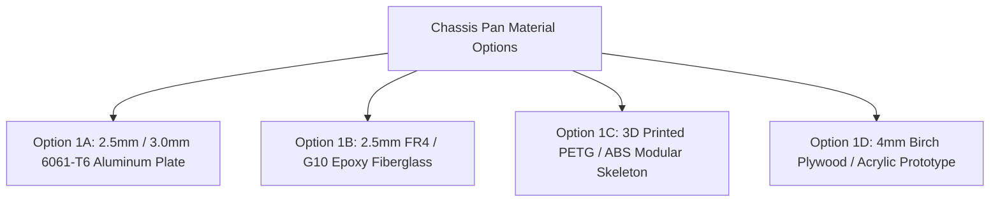
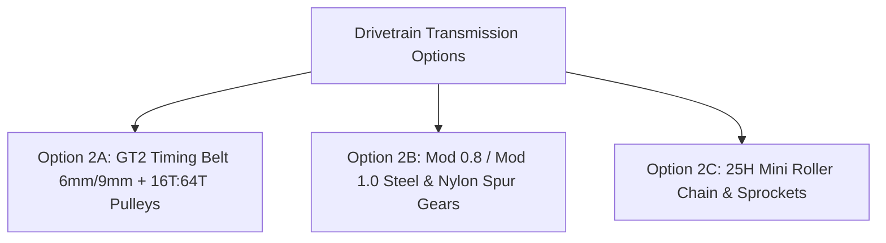
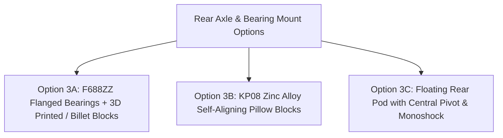
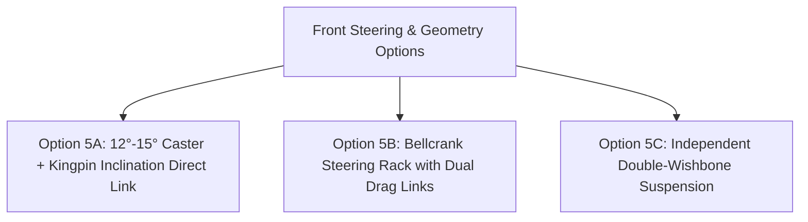

# RWD RC Race Kart: Comprehensive Subsystem Engineering Options & Trade-Off Study

This document details the architectural options, engineering trade-offs, and deep **Pros and Cons** for every critical subsystem of the scratch-built 1/10 RWD RC Race Kart designed for the **Team Oorja F1 RC Competition** (Outdoor Redstone Tiles track, 12m × 7.4m footprint, 0.6m track width, 1.0m hairpin turns).

---

## 1. Chassis Pan & Structural Material Options

The chassis must withstand outdoor redstone tile seams (2–5 mm vertical drops/gaps) while providing the precise torsional compliance required for a solid-axle kart to lift its inside rear wheel during cornering.



### Options Breakdown

| Specification | Option 1A: 2.5mm 6061-T6 Aluminum | Option 1B: 2.5mm FR4 / G10 Fiberglass | Option 1C: 3D Printed PETG / ABS Skeleton | Option 1D: 4mm Birch Plywood / Acrylic |
| :--- | :--- | :--- | :--- | :--- |
| **Density & Weight** | ~2.70 g/cm³ (~280g pan) | ~1.85 g/cm³ (~195g pan) | ~1.27 g/cm³ (~220g skeleton) | ~0.70 g/cm³ (Wood) / 1.18 g/cm³ (Acrylic) |
| **Tensile Strength** | ~310 MPa (Very High) | ~300 MPa (Very High) | ~50 MPa (Moderate) | ~40 MPa (Wood) / ~70 MPa (Brittle) |
| **Torsional Elasticity** | Stiff; requires narrow waist cuts | **Ideal elastic memory (spring-like)** | Flexible, but creeps under sustained load | Wood creeps; Acrylic shatters on impact |
| **Tile Seam Impact Resistance** | Impervious; scratches only | Impervious; will not crack | Tabs can shear off on 5mm tile edges | Acrylic shatters; Plywood splinters |
| **Fabrication Method** | Hand jigsaw, drill press, or CNC | Hand jigsaw + dust mask, or CNC | FDM 3D Printer (No machine shop needed)| Laser cut or hand saw |
| **Local Cost in India** | ₹450 – ₹700 (Metal scrap/dealer) | ₹650 – ₹1,100 (Robu.in / ElectronicsComp)| ₹300 – ₹500 (Filament spool fraction) | ₹150 – ₹250 (Hardware store) |

### In-Depth Pros & Cons

#### Option 1A: 2.5mm 6061-T6 Aluminum Plate
* **Pros**:
  * **Exceptional Structural Durability**: Will survive 40 km/h head-on barrier collisions without cracking.
  * **Thermal Heatsink Benefit**: Acts as a massive ground plane and conduction heatsink for the ESC and motor mount brackets.
  * **Precision Threading**: Holes can be tapped with M3/M4 threads directly into the plate, eliminating loose nuts underneath the chassis.
  * **Low Center of Gravity (CoG)**: Bottom-heavy mass keeps the kart glued to the tiles during high-speed direction changes.
* **Cons**:
  * **Plastic Deformation Risk**: If bent severely in a crash, aluminum stays bent and must be hammered straight.
  * **Fabrication Effort**: Requires metal cutting blades, lubricating fluid, and deburring of sharp edges.
  * **Conductivity**: Must use insulating nylon standoffs for ESP32 and relay PCBs to prevent short circuits.

#### Option 1B: 2.5mm FR4 / G10 Epoxy Fiberglass (Recommended Alternative)
* **Pros**:
  * **Perfect Spring Torsional Memory**: Returns to 100% true flat even after severe torsional twisting; ideal for kart "jacking" flex.
  * **100% Non-Conductive**: Safe against electrical shorts; electronics can mount directly onto the board.
  * **30% Lighter than Aluminum**: Saves ~85g of dead weight, improving acceleration out of slow hairpins.
* **Cons**:
  * **Hazardous Dust**: Inhaling fiberglass dust during cutting/drilling is hazardous; requires wet cutting, N95 respirator, and eye protection.
  * **Thread Stripping**: Cannot hold tapped threads reliably; requires M3 locknuts and washers.

#### Option 1C: 3D Printed PETG / ABS Skeleton
* **Pros**:
  * **Rapid Iteration**: Can incorporate complex integrated wire channels, battery trays, and servo mounts in CAD.
  * **Zero Manual Cutting**: Slices in Cura/Bambu Studio and prints overnight.
* **Cons**:
  * **Layer Delamination**: 2–5 mm tile seams create cyclic shear stresses that can snap printed chassis tabs along layer lines.
  * **Thermal Creep**: A2212 motor mounts can reach 60°C–70°C, softening PETG/PLA and causing motor pinion misalignment.

---

## 2. Drivetrain & Transmission Options

The drivetrain must step down the 1400KV motor RPM (10,360 RPM unloaded at 7.4V nominal) to achieve a target speed of **35–42 km/h** with 65mm tires while handling explosive full-throttle launches.

$$\text{Motor RPM} = 1400\text{ KV} \times 7.4\text{ V} = 10,360\text{ RPM}$$
$$\text{Wheel Circumference} = \pi \times 0.065\text{ m} = 0.2042\text{ m}$$
$$\text{Target Speed Ratio (4:1)} \implies \text{Axle RPM} = 2,590\text{ RPM} \implies \text{Speed} \approx 31.7\text{ km/h (Loaded: ~38 km/h at 8.4V)}$$



### Options Breakdown

| Feature | Option 2A: GT2 Timing Belt (16T:64T) | Option 2B: Mod 0.8 / 1.0 Spur Gears | Option 2C: 25H Mini Roller Chain |
| :--- | :--- | :--- | :--- |
| **Efficiency** | ~96% – 98% (High) | ~94% – 96% | ~88% – 92% |
| **Noise & Harshness** | **Near Silent; Dampens shockloads** | Audible gear whine; rigid mesh | Loud metallic rattle |
| **Tile Grit Tolerance** | High; rubber belt flexes over dust | Low; sand pebbles lock teeth | Very high; pushes grit through links |
| **Slip Under Hard Braking** | Zero slip with correct tension | Zero slip (Rigid) | Zero slip |
| **Weight** | ~45g total | ~95g total (Metal/nylon) | ~180g total (Heavy steel chain) |
| **Center Distance Adjustability**| Requires slotted motor mount | Requires ultra-precise backlash (<0.1mm)| Tolerates loose center; needs chain breaker |
| **Availability in India** | Omnipresent (3D printer spares, ₹250)| RC hobby shops (Costly, ₹600–₹1,200) | Motorcycle/industrial spares (₹500–₹800)|

### In-Depth Pros & Cons

#### Option 2A: GT2 Synchronous Timing Belt & Pulleys (Recommended)
* **Pros**:
  * **Elastic Shock Damping**: The fiberglass-reinforced neoprene rubber belt absorbs the high-frequency shock when tires slam into 2–5mm redstone tile seams, saving the motor bearings and shaft from bending.
  * **Widespread Local Sourcing**: Standard 3D printer parts (Robu.in, Amazon.in) with 5mm bore for motor and 8mm bore for rear axle.
  * **Zero Lubrication Needed**: Unlike gears or chains, GT2 belts run dry and will not attract abrasive redstone tile grit into the powertrain.
* **Cons**:
  * **Tension Sensitivity**: If belt tension is too loose, teeth can skip under aggressive hard-braking; if too tight, it adds radial drag to motor bearings.
  * **Axle Pulley Diameter**: A 64T GT2 pulley has an outer diameter of ~40.2 mm. With 65mm tires, this leaves **12.4 mm** of radial clearance to the ground (must be enclosed with a skid guard to satisfy Rule 3.1.4).

#### Option 2B: Mod 0.8 / Mod 1.0 Spur Gears
* **Pros**:
  * **Ultra-Compact Diameter**: A 45T Mod 0.8 spur gear has a diameter of only ~36mm, granting superior ground clearance.
  * **Crisp Throttle Response**: Instantaneous torque transfer with zero belt deflection.
* **Cons**:
  * **Catastrophic Pebble Jamming**: Redstone tile tracks have loose stone grains. A single 1.5mm pebble caught between gear teeth will lock the rear axle instantly and strip teeth.
  * **Chassis Flex Sensitivity**: As the chassis pan flexes to lift the inside wheel, the gear mesh angle changes slightly, causing binding and premature tooth wear unless mounted in a rigid enclosed sub-frame.

---

## 3. Rear Axle & Bearing Mounting Options

The rear axle supports 60% of the vehicle mass and must rotate freely under lateral cornering loads without binding or bending.



### Options Breakdown

| Parameter | Option 3A: F688ZZ Flanged Bearings | Option 3B: KP08 Zinc Pillow Blocks | Option 3C: Floating Rear Pod (F1 Style)|
| :--- | :--- | :--- | :--- |
| **Bearing Dimensions** | 8mm ID × 16mm OD × 5mm Width | 8mm ID × 55mm Length × 29mm Height | F688ZZ mounted in articulating sub-pod |
| **Total Assembly Mass** | **~35 grams (Ultra-light)** | ~140 grams (Bulky & heavy) | ~110 grams (Complex linkages) |
| **Self-Alignment** | Rigid (Requires square mounting) | **Spherical insert self-aligns $\pm 5^\circ$**| Articulates via central ball & flex plates|
| **Ground Clearance Fit** | Compact; mounts easily within 15mm | Tall; lifts axle or protrudes below pan | Adjustable via shock ride-height collar |
| **Chassis Flex Synergy** | Excellent when mounted to main pan | Poor (Adds excessive local stiffness) | Perfect (Separates roll from pitch flex)|
| **Cost in India** | ₹120 for 4x F688ZZ (Robu.in) | ₹280 for 2x KP08 (Amazon.in/Robu) | ₹800 – ₹1,400 (Springs, ball studs, dampers)|

### In-Depth Pros & Cons

#### Option 3A: F688ZZ Flanged Bearings in Compact Blocks (Recommended for Pure Kart)
* **Pros**:
  * **True Go-Kart Simplicity**: Directly mimics authentic racing karts (Tony Kart / CRG). Keeps weight at the absolute minimum.
  * **Flanged Retention**: The outer flange (18mm OD) locks the bearing axially against the chassis upright, preventing lateral axle play during high-G slides.
  * **Low Friction**: Miniature precision chrome steel balls spin with minimal rolling resistance.
* **Cons**:
  * **Alignment Sensitivity**: Both left and right uprights must be drilled perfectly collinear ($\le 0.1\text{mm}$ error), or the 8mm axle will bind. (Solved by drilling both uprights clamped together in a drill press).

#### Option 3B: KP08 Zinc Alloy Pillow Blocks
* **Pros**:
  * **Foolproof Self-Alignment**: The internal spherical bearing cartridge rotates inside the zinc housing, allowing the axle to spin freely even if your chassis pan is twisted or misaligned.
  * **Built-in Grub Screws**: Dual set screws lock directly onto the 8mm axle rod without needing external shaft collars.
* **Cons**:
  * **Excessive Weight**: Adds over 100g of dead weight at the rear axle.
  * **Height Clearance Issues**: The base-to-center height of KP08 is 15mm. When combined with 65mm wheels (axle centerline at 32.5mm), the pillow block leaves very limited ground clearance above the tiles.

#### Option 3C: Floating Rear Pod Suspension
* **Pros**:
  * **Suspension Compliance**: Allows the rear axle to float over 5mm tile steps without upsetting front steering geometry.
  * **Adjustable Damping**: Spring rates and oil damping can be tuned for varying grip levels.
* **Cons**:
  * **High Fabrication Complexity**: Requires 3-point ball pivots, side link rods, and central coilover shock.
  * **Timeline Drag**: Adds 4–6 days of machining and tuning to the project.

---

## 4. Directional Reversing & Braking System Options

The Team Oorja Rulebook strictly prohibits touching the car on track (Rule 10.1). If your kart understeers into a barrier or sandbag, you must reverse electronically to unstick yourself.

```mermaid
graph TD
    RevOptions[Reverse & Braking Options]
    RevOptions --> Rev1[Option 4A: Relays + ESC Dynamic Hard Brake]
    RevOptions --> Rev2[Option 4B: Micro-Servo Mechanical Disc Brake + Relays]
    RevOptions --> Rev3[Option 4C: Bi-directional ESC Firmware Flash (BLHeli/3D)]
```

### Options Breakdown

| Feature | Option 4A: Relays + ESC Dynamic Brake | Option 4B: Mechanical Disc Brake + Relays | Option 4C: ESC Firmware Flashing |
| :--- | :--- | :--- | :--- |
| **Components** | 2-Ch / 4-Ch 5V Relay + Stock ESC | Micro Servo + Steel Disc + 2-Ch Relay | Direct ESC reprogramming (USB linker)|
| **Hardware Complexity**| Moderate (Silicone wire soldering) | High (Caliper, cable, rotor on axle)| Low (Software flash only) |
| **Braking Power** | **Strong (Regenerative/dynamic)** | Strong (Friction pad clamping) | Strong (Active PWM braking) |
| **Zero-RPM Transition**| Software dead-time (150ms delay) | Mechanical brake locks, then relay clicks| Instantaneous bi-directional PWM |
| **Vibration Robustness**| Needs foam-tape mounting on tiles | Cable can stretch; pads glaze | 100% solid state (No mechanical parts)|
| **Compatibility** | **Works with 100% of vendor ESCs** | Universal | **High bricking risk on airplane ESCs**|

### In-Depth Pros & Cons

#### Option 4A: Relay Phase-Swapper + ESC Dynamic Brake (Recommended)
* **Pros**:
  * **Guaranteed Compatibility**: Works with the exact 80A Airplane ESC and SimonK ESCs sitting in your vendor's shop right now. Zero risk of bricking firmware.
  * **Independent Brake & Reverse**: Pulling the transmitter trigger applies 100% ESC electronic brake without engaging reverse. Reverse is locked behind a deliberate double-tap state machine.
  * **Zero Drag in Forward Motion**: Relays sit de-energized (Normally Closed contacts) during 98% of the race, consuming zero coil power while driving forward.
* **Cons**:
  * **Mechanical Chatter Risk**: Tile vibrations could momentarily bounce relay contacts if cheap automotive relays are used. (Mitigated by using quality Songle 10A sealed relays mounted on double-sided silicone vibration foam).
  * **Mandatory Software Interlock**: If relays switch while the motor is spinning at 10,000 RPM, massive back-EMF arcs will pit the relay contacts. Firmware MUST enforce a 150ms dead-time delay.

#### Option 4C: Flashing Bi-directional ESC Firmware
* **Pros**:
  * **Zero Relay Weight**: Saves 60g–120g of relays and heavy wiring.
  * **Instant Throttle Reversal**: Seamless forward-to-reverse like a commercial RC car ESC.
* **Cons**:
  * **High Risk of Bricking Vendor ESC**: The vendor's 80A ESC has an unknown MCU (often a locked Silabs or proprietary chip). Attempting to flash BLHeli or SimonK 3D can permanently destroy the ESC.
  * **Extreme Reverse Sensitivity**: Drivers can accidentally throw the car into full reverse while trying to brake hard at the end of the straight, causing high-speed rollovers.

---

## 5. Front Steering & Suspension Geometry Options

Solid rear axles create extreme understeer unless the front suspension geometry actively "jacks" the chassis to offload the inside rear tire.



### Options Breakdown

| Attribute | Option 5A: 12°-15° Caster Direct Link | Option 5B: Dual Bellcrank Rack | Option 5C: Independent Double Wishbone |
| :--- | :--- | :--- | :--- |
| **Part Count** | **Minimal (4 moving parts)** | Moderate (8 moving parts) | High (16+ moving parts, 4 ball joints)|
| **Weight** | ~45g complete | ~75g complete | ~160g complete |
| **Jacking Effect** | **Maximum (Lifts inside rear wheel 2mm)**| Moderate | Zero (Suspension absorbs jacking force)|
| **Tile Bump Absorption**| Relies on front tire sidewall flex | Relies on tire sidewall flex | High (Coilovers absorb tile seams) |
| **Bump Steer** | Minimal (Direct servo horn to knuckles) | Zero (Parallel tie rods) | Moderate unless geometry is tuned |
| **Cost in India** | ₹250 (MG90S servo + M3 rod ends) | ₹450 (Bellcrank kit + bearings) | ₹1,200 – ₹2,000 (A-arms, knuckles, shocks)|

### In-Depth Pros & Cons

#### Option 5A: 12°–15° Caster Direct Linkage (Recommended for Pure Kart)
* **Pros**:
  * **Solves Solid-Axle Understeer**: When the steering is turned, the 15° caster angle pushes the outside front wheel down and pulls the inside front wheel up. Through chassis diagonal transfer, this **lifts the inside rear wheel 1.5–2.0 mm off the ground**, eliminating tire scrub and allowing the kart to pivot effortlessly through 1.0m hairpins!
  * **Self-Centering Stability**: High positive caster provides immense straight-line directional stability down the 7-meter main straight.
  * **Zero Slop**: Direct linkage from the metal-gear MG90S servo eliminates bellcrank joint play.
* **Cons**:
  * **Higher Steering Torque Required**: Jacking the chassis requires the servo to lift part of the vehicle's sprung weight. Requires a metal-gear servo (MG90S or MG996R) rather than a cheap nylon SG90.

---

## 6. Power Distribution & Connectors

| System Component | Recommended Choice | Alternative | Rationale & Safety Rule |
| :--- | :--- | :--- | :--- |
| **Main Battery Plug** | **Amass XT60H (Yellow)** | Deans T-Plug | The vendor's 80A ESC has a Deans plug, but the A3SD 80C battery has an XT60. Solder a genuine XT60H directly to the ESC. XT60 handles 60A continuous with lower contact resistance and will not disconnect over bumpy tiles. |
| **BEC Power Routing** | **Dedicated ESC 5V BEC for MCU; Split for Servo** | External 3A UBEC | In Timeline 1, the 80A ESC's internal 5V 5A switching BEC easily powers ESP32-S3, relays, and MG90S servo. In Timeline 2 & 3, isolate the two 30A ESC 5V red wires to prevent ground loops. |
| **Phase Wiring** | **14 AWG / 16 AWG Flexible Silicone Wire** | Standard PVC Wire | High-strand silicone wire resists fatigue from chassis flex and high-frequency motor vibration over tile joints. |

---

## 7. Master Subsystem Selection Summary

| Subsystem | Selected Configuration | Primary Rationale |
| :--- | :--- | :--- |
| **Chassis Pan** | **2.5mm 6061-T6 Aluminum (or 2.5mm FR4)** | Indestructible on 2–5mm tile seams; provides perfect torsional flex waist. |
| **Transmission** | **GT2 6mm Timing Belt (16T:64T, 4:1 Ratio)** | Absorbs tile shockloads; immune to sand/grit lockups; 38 km/h top speed. |
| **Rear Axle** | **8mm Ground Steel Rod + F688ZZ Flanged Bearings** | Ultra-lightweight, high-rigidity, zero lateral play during high-G drifts. |
| **Directional Reverse** | **2-Ch / 4-Ch Relay Board with 150ms Dead-Time Delay**| 100% reliable with vendor's stock ESCs; protects motor and relay contacts. |
| **Front Geometry** | **12°–15° Positive Caster + Direct Servo Linkage** | Essential "jacking" effect lifts inside rear wheel to conquer 1.0m hairpins. |
| **Connectors** | **Amass XT60H Connectors Throughout** | High current, vibration-proof retention over redstone tile seams. |
