# Timeline 1: "The Rapid Racer" — Complete Engineering Build Manual
**Configuration:** 1x A2212 1400KV Brushless Motor • 1x 80A Airplane ESC (Hard Brake) • Single Solid 8mm Live Axle (Shaft 1)
**Estimated Build Time:** 3 – 5 Days • **Total Component Budget to Spend:** ~₹1,850 – ₹2,300

---

## 1. Executive Summary & Locked-In Architecture
Timeline 1 is the recommended race-winning configuration for the Team Oorja F1 RC Competition (Division B). It delivers the lightest curb weight (~680g), highest vibration reliability over 2–5mm redstone tile seams, and uses parts immediately available from local vendors today.

### Locked-In Specifications:
* **Chassis Platform:** 2.5mm 6061-T6 Aluminum Plate with narrow waist flex cutouts + 3D-printed modular PETG nerf bars and front bumper (interchangeable with 2.5mm G10/FR4 sheet).
* **Ground Clearance & Bump Protection:** 15.0mm static ride height (+3mm safety buffer over Rule 3.3.4) with a 30° rockered "ski-ramp" front skid plate to glide effortlessly over raised tile lips.
* **Transmission:** GT2 Timing Belt (16T Motor : 64T Axle, 4.0:1 Reduction) with slotted motor plate and an active 623ZZ ball-bearing idler snubber (210° wrap, 10 teeth in mesh, 0% skip risk).
* **Steering Geometry:** Pure Kart Dynamic Jacking (14° Positive Caster + 6° KPI Rigid Kingpin, 0 springs) — mechanically jacks the inside rear tire 1.5mm off tiles during turns, eliminating understeer on the locked live axle.
* **Reverse Control:** Dedicated Manual Driver Button (Game Controller button or RC Ch3 switch) with mandatory 150ms zero-RPM dead-time interlock in ESP32 firmware.
* **Battery & Weight Balance:** Asymmetric Left-Pod Battery Counterbalance (135g 2S LiPo on left side directly counterbalancing 60g motor + 75g ESC on right side, producing near-perfect 50.5%/49.5% weight distribution and 18mm CG).
* **Rear Wheel Hubs:** 8mm precision steel shaft with hand-filed 10mm flat D-cuts, clamped into 12mm hex wheel adapters with dual M4 hardened cone-point grub screws.
* **Controller Interface:** Dual-compatible ESP32-S3 firmware supporting immediate Bluetooth Gamepad (PS4/Xbox/8BitDo via Bluepad32) and modular ESP-NOW expansion.

---

## 2. Complete Bill of Materials (BOM) & Budget (in ₹ INR)

| Item # | Component Description | Source / Notes | Qty | Est. Cost (₹ INR) | Status |
| :---: | :--- | :--- | :---: | :---: | :---: |
| 1 | **ESP32-S3 Development Board** | On hand | 1 | ₹0 (Owned) | ✅ In hand |
| 2 | **A2212 1400KV Brushless Outrunner** | Local vendor / Robu.in | 1 | ₹350 – ₹420 | 🛒 To procure |
| 3 | **80A Brushless Airplane ESC (E203950)** | Local vendor (with Hard Brake) | 1 | ₹850 – ₹1,050| 🛒 To procure |
| 4 | **A3SD 2S (7.4V/8.4V) 2200mAh 80C LiPo** | Local vendor (XT60 plug) | 1 | ₹750 – ₹900 | 🛒 To procure |
| 5 | **2-Channel 5V Relay Module (10A/250V)** | Local electronics shop | 1 | ₹110 – ₹140 | 🛒 To procure |
| 6 | **MG90S Metal Gear Micro Servo** | Local hobby vendor | 1 | ₹180 – ₹220 | 🛒 To procure |
| 7 | **8mm Precision Ground Steel Rod (240mm)** | Hardware / 3D printer supplier | 1 | ₹120 – ₹160 | 🛒 To procure |
| 8 | **F688ZZ Flanged Ball Bearings (8x16x5mm)** | 3D printer parts supplier | 2 | ₹80 – ₹100 | 🛒 To procure |
| 9 | **623ZZ Ball Bearing (Idler Snubber)** | 3D printer parts supplier | 1 | ₹15 – ₹25 | 🛒 To procure |
| 10 | **GT2 16T Aluminum Motor Pulley (3.17mm bore)** | 3D printer parts supplier | 1 | ₹60 – ₹80 | 🛒 To procure |
| 11 | **GT2 Closed Timing Belt (6mm wide, ~200mm)**| 3D printer parts supplier | 1 | ₹70 – ₹90 | 🛒 To procure |
| 12 | **2.5mm Aluminum Sheet (Scrap piece 350x200mm)**| Local metal/window fabricator | 1 | ₹300 – ₹450 | 🛒 To procure |
| 13 | **65mm RC Rubber Touring Slick Wheels (Hex 12mm)**| Local vendor / Robu.in | 4 | ₹400 – ₹550 | 🛒 To procure |
| 14 | **M3 & M4 Screws, Locknuts & Grub Screws** | Hardware shop | Assorted | ₹100 – ₹150 | 🛒 To procure |
| 15 | **3D Printed PETG Parts (Filament)** | Self-printed (~250g) | 1 | ₹250 | 🖨️ To print |
| **TOTAL**| **Estimated Total Spend to Complete Timeline 1** | | | **₹3,635 – ₹4,595** *(or ~₹2,100 excluding wheels/battery if already budgeted)* | |

---

## 3. Step-by-Step 5-Day Execution Roadmap

```mermaid
gantt
    title Timeline 1: 5-Day Build Schedule
    dateFormat  D
    axisFormat Day %d
    section Day 1: Electronics & Bench
    Procure Battery, 80A ESC, Motor, Relay, Hardware :done, d1_1, 1, 1d
    Program ESC via ESP32-S3 (Hard Brake, 15 deg, 16kHz) :active, d1_2, after d1_1, 1d
    Verify Stop Time (<120ms) & Manual Reverse Relay :d1_3, after d1_2, 1d
    section Day 2-3: Mechanical Build
    Cut 2.5mm Aluminum Pan with Waist Flex Cutouts :d2_1, after d1_3, 1d
    Mount 8mm Axle + F688ZZ Bearings + 16T:64T Belt :d2_2, after d2_1, 1d
    Assemble 14 deg Caster Knuckles & MG90S Steering :d2_3, after d2_2, 1d
    File 10mm D-Cuts on Axle & Mount 12mm Hex Hubs :d2_4, after d2_3, 1d
    section Day 4-5: System Integration & Race Tuning
    Mount Left Battery Pod & Right Motor/ESC (50/50 balance) :d3_1, after d2_4, 1d
    Flash Bluepad32 / ESP-NOW Firmware + Fail-Safe :d3_2, after d3_1, 1d
    Tile Bump Test (15mm ride height + 30 deg skid nose) :d3_3, after d3_2, 1d
    Full 8-Lap Endurance & Inside-Wheel Lift Validation :d3_4, after d3_3, 1d
```

### Day 1: Electronics Setup & Bench Calibration
1. **ESC Programming via `firmware/esc_programmer.ino`**:
   * Connect ESP32-S3 GPIO 18 to ESC signal wire, GND to ESC ground.
   * Power ESC with the A3SD 2S LiPo. Enter programming mode via Serial Monitor (115200 baud).
   * Lock in parameters:
     - **Cell Count:** 2S LiPo (Autodetect / 2S)
     - **Brake Setting:** **HARD BRAKE** (Critical for instantaneous zero-RPM spin-down)
     - **Timing:** 15° (Normal for 14-pole A2212)
     - **PWM Frequency:** 16 KHz
2. **Phase-Swapping Relay Bench Test**:
   * Wire Relay Channel 1 to Motor Phase A, Relay Channel 2 to Motor Phase B.
   * Send test throttle pulse (1500 µs forward), push manual reverse button:
   * Verify that ESP32 cuts throttle to 1000 µs $\to$ pauses 150ms $\to$ clicks relay contacts $\to$ ramps reverse throttle to 1400 µs with zero sparking or contact arcing.

### Day 2–3: Chassis Cutting & Drivetrain Assembly
1. **Chassis Plate Fabrication**:
   * Print 1:1 paper cutting template for 2.5mm Aluminum plate.
   * Trace onto sheet; cut outer profile using jigsaw or hacksaw.
   * Cut the **narrow waist cutouts** (narrowing middle width from 160mm to 95mm). This allows the chassis to twist torsionally just like a real race kart!
   * Drill M3 mounting holes for rear bearing blocks, front steering bulkhead, and battery tray.
2. **Rear Live Axle Installation**:
   * Press two F688ZZ flanged bearings into 3D-printed rear pillow blocks.
   * Slide the 8mm ground steel rod through. Lock axial float using two 8mm shaft lock collars with set screws.
   * Install the 3D-printed 64T GT2 pulley on the axle.
   * Mount the A2212 motor on the right-side slotted plate with the 16T steel pulley.
   * Install the 623ZZ idler snubber bearing pressing on the belt back to establish a 210° wrap angle. Tighten motor slot bolts.
3. **Axle D-Cut & Wheel Hubs**:
   * Use a flat metal hand file to file a 10mm flat spot on both ends of the 8mm steel axle.
   * Slide 3D-printed 12mm hex adapters over the ends. Tighten dual M4 cone-point grub screws firmly onto the flat spots. Mount 65mm rubber slick wheels.
4. **Front Steering Assembly**:
   * Bolt 3D-printed front bulkhead with built-in **14° positive caster** and **6° KPI**.
   * Mount 3D-printed steering knuckles with M4 shoulder screws.
   * Connect MG90S metal gear servo horn to knuckles using M3 ball-cup linkages with built-in Ackermann geometry.

### Day 4–5: Electronics Mounting, Software & Track Validation
1. **Weight Balance Placement**:
   * Strap the 135g 2S LiPo into the **Left Side-Pod**.
   * Mount the 80A ESC on the **Right Side-Pod** ahead of the A2212 motor.
   * Place ESP32-S3 and relay module along the central tunnel. Verify lateral balance on a center pivot (achieves 50.5% / 49.5% Left/Right balance).
2. **Firmware Upload**:
   * Flash `firmware/race_kart_controller.ino`.
   * Pair Bluetooth controller (or connect RC receiver). Verify:
     - Left stick: Steering with dynamic travel limits.
     - Right trigger: Forward acceleration.
     - Left trigger: 100% electronic hard brake.
     - Button `Y` / `Triangle`: Dedicated Reverse Toggle.
     - Signal loss failsafe: Car stops within 250ms of transmitter disconnect.
3. **Tile Seam & Track Testing**:
   * Set ground clearance to **15.0mm**. Attach the 30° rockered front ski-ramp skid plate.
   * Drive over 2–5mm tile gaps at 10, 20, and 35 km/h: Verify smooth gliding without nose-catching.
   * Test tight 1.0m hairpins: Observe dynamic chassis jacking lifting the inside rear tire 1.5mm off the ground, allowing clean, razor-sharp cornering with zero understeer!
