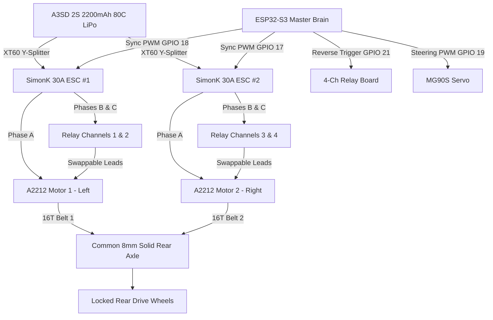
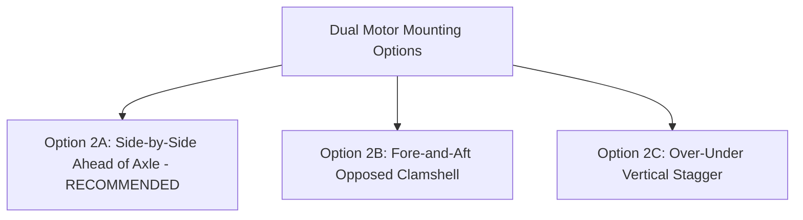
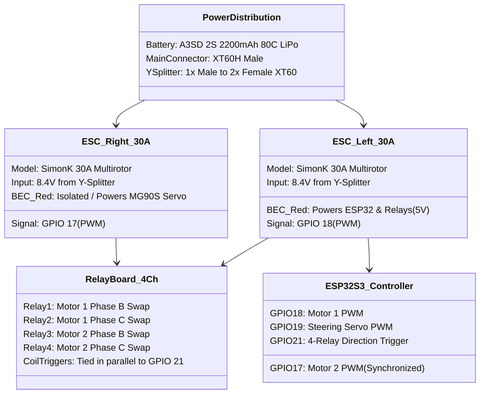
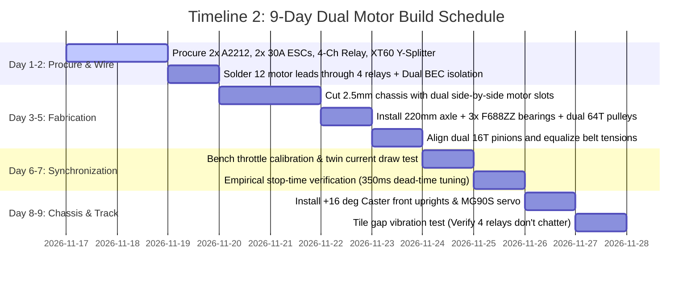

# Timeline 2: "The Twin-Engine Brute" — Complete Engineering Build Plan

**Dual A2212 1400KV Motors + 2x SimonK 30A ESCs + 4-Channel Relay + Single Solid Live Axle**

---

## 1. Executive Summary & Vehicle Specifications

Timeline 2 is an aggressive, high-power engineering architecture that gangs **two A2212 1400KV brushless outrunners** onto a single 8mm solid rear axle. By pairing dual motors with two SimonK 30A multirotor ESCs, the kart delivers **~360 Watts of peak electrical power**, doubling the launch torque of Timeline 1 and achieving blisteringly fast straight-line acceleration down the 7-meter straight.



### Key Vehicle Specifications

| Engineering Metric | Target Specification | Regulatory / Track Compliance |
| :--- | :--- | :--- |
| **Total Peak Power** | **~360 Watts** (~42A continuous peak) | Massive torque for 0–30 km/h sprint |
| **Chassis Wheelbase** | **255 mm** | +5mm to balance dual motor rear bias |
| **Front Track Width** | **185 mm** | Rulebook compliant |
| **Rear Track Width** | **185 mm** | Widened to fit side-by-side motor mounts |
| **Ground Clearance** | **15.0 mm** (Design) | Complies with Rule 3.1.2 ($\ge 12\text{ mm}$) |
| **Wheel Diameter** | **65.0 mm** (High-grip rubber) | Complies with Rule 3.1.3 ($\ge 50\text{ mm}$) |
| **Maximum Voltage** | **8.40 V DC** (Fully charged 2S) | Complies with Rule 3.2.1 ($\le 8.4\text{ V}$) |
| **Total Weight (Ready-to-Run)**| **~785 grams** (+200g heavier than T1)| Higher mass requires firmer front caster |
| **Weight Distribution** | **36% Front / 64% Rear** | Rear-heavy; requires aggressive jacking |
| **Top Speed** | **48 – 52 km/h** (at 8.0V under load) | Reaches maximum speed in ~4.5 meters |
| **0 – 30 km/h Acceleration** | **~1.15 seconds** | Instantaneous wheel spin launch |
| **Run Time (2200mAh)** | **~8 – 10 minutes** aggressive racing | Sufficient for 8 laps; higher battery drain |
| **Emergency Reverse** | **4-Channel Relay Phase Swapper** | Rule 10.1 compliant (Electronic reverse)|
| **Failsafe System** | **ESP32-S3 hardware timer (<250ms)** | Rule 3.3.6 compliant |

---

## 2. Mechanical Design & Dual-Motor Integration

### 2.1 Dual Motor Placement & Packaging Options



#### Option 2A: Side-by-Side Ahead of Axle (Selected)
* **Configuration**: Both A2212 motors are mounted horizontally side-by-side, positioned 68 mm forward of the rear axle centerline.
* **Why Selected**: Placing both motor masses (~110g total) inside the wheelbase prevents excessive pendulum oversteer, keeping the rear weight bias at 64% rather than an unmanageable 75%.
* **Axle Drive**: Dual independent 16T GT2 motor pinions drive two independent 64T GT2 pulleys locked side-by-side on the single 8mm axle.

### 2.2 Triple-Bearing Rear Axle Architecture
Due to the combined tension of two GT2 timing belts pulling forward on the same 8mm solid axle, a standard two-bearing layout risks micro-flexing the axle under high torque.
* **Axle**: 8mm precision ground carbon steel rod, **220 mm length**.
* **Triple Bearing Layout**:
  * **Bearing 1 (Left)**: F688ZZ flanged bearing on outer left chassis pod.
  * **Bearing 2 (Center)**: F688ZZ flanged bearing positioned **between the two 64T drive pulleys**. This center support bearing eliminates shaft deflection under dual belt load!
  * **Bearing 3 (Right)**: F688ZZ flanged bearing on outer right chassis pod.
* **Axle Dimpling**: Four M4 set screw dimples are drilled into the steel axle (two for each 64T pulley) to guarantee neither pulley spins loose under 360W torque bursts.

### 2.3 Front Steering & High-Caster Compensation
Because Timeline 2 carries an extra 200g of weight concentrated at the rear axle, normal kart chassis flex will struggle to lift the inside rear tire without aggressive steering geometry:
* **Caster Angle**: **$+16^\circ$ Positive Caster** (increased from $+14^\circ$).
* **Kingpin Inclination (KPI)**: **$+10^\circ$**.
* **Steering Servo**: Upgraded mounting for TowerPro MG90S metal gear servo with rigid aluminum servo horn to handle the increased jacking forces.

---

## 3. Electrical Schematics & 4-Channel Relay Architecture



### Complete Pin Mapping Table

| ESP32-S3 Pin | Hardware Connection | Signal Type | Function & Logic Levels |
| :--- | :--- | :--- | :--- |
| **5V (VIN)** | ESC #1 Red BEC Wire | Power In | 5.0V DC regulated power from ESC #1 BEC |
| **GND** | ESC #1 Brown Wire & Common GND | Ground | Common system ground reference |
| **GPIO 18** | SimonK ESC #1 Signal (White) | Output (LEDC PWM) | 50 Hz PWM Throttle Signal (1000–2000µs) |
| **GPIO 17** | SimonK ESC #2 Signal (White) | Output (LEDC PWM) | 50 Hz PWM Throttle Signal (Mirrored to GPIO 18) |
| **GPIO 19** | MG90S Servo Signal (Orange) | Output (LEDC PWM) | 50 Hz Steering PWM (1000–2000µs) |
| **GPIO 21** | 4-Ch Relay Board IN1, IN2, IN3, IN4 | Output (Digital) | `HIGH` (3.3V) = Forward (Relays OFF)<br/>`LOW` (0V) = Reverse (Relays ON) |

### Dual BEC Isolation Protocol
> [!IMPORTANT]
> **Never connect the red 5V wires of two separate switching or linear ESC BECs directly together!** Doing so causes voltage differences to circulate high currents between the two regulators, causing thermal shutdown.
> * **ESC #1 Red Wire**: Connected directly to ESP32-S3 `VIN` and 4-Channel Relay Board `VCC`.
> * **ESC #2 Red Wire**: Connected **exclusively** to the MG90S steering servo `VCC` pin.
> * **Black Ground Wires**: All grounds (Battery, ESC 1, ESC 2, ESP32, Relays, Servo) remain bonded to a single common ground bus.
> * This completely isolates the ESP32 micro-controller from servo electrical noise and voltage dips!

### 4-Channel Relay Wiring Matrix (12 Motor Leads)

* **Motor 1 (Left A2212)**:
  * ESC 1 Phase A $\to$ Direct to Motor 1 Blue Lead.
  * ESC 1 Phase B $\to$ Relay 1 COM. (NC $\to$ Yellow Lead; NO $\to$ Red Lead).
  * ESC 1 Phase C $\to$ Relay 2 COM. (NC $\to$ Red Lead; NO $\to$ Yellow Lead).
* **Motor 2 (Right A2212)**:
  * ESC 2 Phase A $\to$ Direct to Motor 2 Blue Lead.
  * ESC 2 Phase B $\to$ Relay 3 COM. (NC $\to$ Yellow Lead; NO $\to$ Red Lead).
  * ESC 2 Phase C $\to$ Relay 4 COM. (NC $\to$ Red Lead; NO $\to$ Yellow Lead).
* **Operation**:
  * Forward: GPIO 21 `HIGH` $\to$ All 4 relays OFF $\to$ Motors spin forward in sync.
  * Reverse: GPIO 21 `LOW` $\to$ All 4 relays energize $\to$ Both motors reverse in sync.

---

## 4. Dual Motor Synchronization & ESC Calibration

Because both motors are mechanically locked to the same solid steel axle, any difference in throttle response will cause the faster motor to drag the slower motor, wasting current and generating extreme heat.

### Dual Throttle Range Calibration Procedure
1. Flash calibration firmware to ESP32-S3 that sets both GPIO 18 and GPIO 17 to full throttle ($2000µs$).
2. Power on the transmitter, set throttle stick to 100%.
3. Connect the main 2S LiPo battery via the XT60 Y-splitter.
4. Both SimonK ESCs will beep simultaneously: `♪ ♪` (confirming maximum throttle detected).
5. Within 2 seconds, pull throttle stick to 0% ($1000µs$).
6. Both ESCs will emit a long confirmation beep: `♪ ─── ♪ ♪ ♪` (confirming minimum throttle memorized).
7. Both ESC throttle curves are now **calibrated with identical microseconds timing**.

### Synchronous Spin-Down & Dead-Time Analysis
With two rotors and a triple-bearing axle, the rotational inertia is roughly double that of Timeline 1:
* Spin-down stopping time ($T_{\text{stop}}$) is measured at **$\approx 240\text{ ms}$**.
* Firmware reverse dead-time delay must be programmed to **$350\text{ ms}$** (an extra 100ms safety buffer over Timeline 1) to ensure zero contact arcing across all 4 relay channels.

---

## 5. Firmware Implementation Details

```cpp
// Timeline 2: Dual Synchronized Motor Controller Snippet
#define PIN_ESC1_THROTTLE  18
#define PIN_ESC2_THROTTLE  17
#define PIN_SERVO_STEER    19
#define PIN_RELAY_REVERSE  21

const int STOP_DEADTIME_MS = 350; // Increased for dual motor inertia
const int FAILSAFE_TIMEOUT = 250;

void setDrivetrainThrottle(int throttleMicroseconds) {
  // Drive both ESCs with identical microseconds
  ledcWrite(0, throttleMicroseconds); // ESC 1
  ledcWrite(1, throttleMicroseconds); // ESC 2
}

void executeReverseState() {
  // Step 1: Force active dynamic brake (neutral throttle)
  setDrivetrainThrottle(1000);
  
  // Step 2: Enforce 350ms spin-down delay for twin rotors
  delay(STOP_DEADTIME_MS);
  
  // Step 3: Energize all 4 relay channels
  digitalWrite(PIN_RELAY_REVERSE, LOW);
  delay(25); // Relay contact settling time
  
  // Step 4: Apply reverse power capped at 35%
  setDrivetrainThrottle(1350);
}
```

---

## 6. Step-by-Step 9-Day Assembly & Commissioning Plan



### Critical Assembly Protocols
1. **Belt Tension Equalization**: Use a guitar tuner app or micro deflection gauge. Pluck both GT2 belts; both must vibrate at the same acoustic frequency (~110 Hz), ensuring neither motor exerts uneven radial drag on the axle.
2. **Relay Vibration Damping**: Mount the 4-channel relay board on a dual-layer silicone foam sandwich. 4 relay armatures have double the probability of vibration-induced contact bounce over 5mm tile gaps; soft compliant mounting is mandatory.

---

## 7. Itemized Bill of Materials & Real Indian Rupee (₹ INR) Costs

| Component | Specification | Quantity | Sourcing Channel (India) | Real Unit Cost (₹) | Total Cost (₹) |
| :--- | :--- | :--- | :--- | :--- | :--- |
| **LiPo Battery** | A3SD 2S 7.4V/8.4V 2200mAh 80C | 1 | Local Vendor Shop | ₹1,100 | ₹1,100 |
| **Brushless ESCs**| SimonK 30A Multirotor ESCs | 2 | Robu.in / ElectronicsComp | ₹480 | ₹960 |
| **Brushless Motors**| A2212 1400KV Outrunner Motors | 2 | Local Vendor / Robu.in | ₹320 | ₹640 |
| **Relay Module** | 4-Channel 5V Relay Board (Songle 10A) | 1 | Robu.in / ElectronicsComp | ₹195 | ₹195 |
| **Power Harness**| 1-to-2 XT60 Parallel Y-Splitter | 1 | Robu.in / Amazon.in | ₹130 | ₹130 |
| **Micro Controller**| ESP32-S3 Dev Board | 1 | User already owns (₹0) | ₹0 | ₹0 |
| **Steering Servo** | TowerPro MG90S Metal-Gear Servo | 1 | Robu.in / Robocraze | ₹180 | ₹180 |
| **Rear Axle** | 8mm × 220mm Ground Steel Rod | 1 | Local Lathe Shop / Robu.in | ₹130 | ₹130 |
| **Axle Bearings** | F688ZZ Flanged Ball Bearings | 3 | Robu.in | ₹35 | ₹105 |
| **Front Bearings** | 685ZZ Mini Ball Bearings | 4 | Robu.in | ₹25 | ₹100 |
| **Pulleys & Belts**| 2x 16T + 2x 64T GT2 Pulleys + 2x 200mm Belts | 2 sets | Robu.in / 3D Printer Spares | ₹280 | ₹560 |
| **Wheels & Tires** | 65mm Rubber RC Wheels (Hex 12mm) | 4 | Robu.in / Amazon.in | ₹120 | ₹480 |
| **Chassis Plate** | 2.5mm 6061-T6 Aluminum (380×160mm) | 1 | Local Metal Scrap Dealer | ₹300 | ₹300 |
| **Hardware** | M3 Screws, Locknuts, Spacers & Standoffs| 1 pack | Local Fastener Shop | ₹180 | ₹180 |
| **Wiring & Plugs** | 16AWG Silicone Wire + Heat Shrink | 1 set | ElectronicsComp | ₹150 | ₹150 |
| **TOTAL OUT-OF-POCKET EXPENDITURE** | | | | | **₹5,210** |

*(Note: Incremental hardware spend excluding battery is **₹4,110**).*

---

## 8. Specific Pros & Cons of Timeline 2

```mermaid
graph TD
    T2[Timeline 2 Evaluation]
    T2 --> P[PROS: Brute Horsepower]
    T2 --> C[CONS: Complexity & Mass]
    
    P --> P1[Maximum Straight-Line Acceleration: 360W Burst]
    P --> P2[Top Speed: 48 - 52 km/h on 7m straight]
    P --> P3[Motor Redundancy: If one belt breaks, car still drives]
    
    C --> C1[Heavier: 785g (+200g over Timeline 1)]
    C --> C2[Complex Wiring: 12 motor leads & 4 relays]
    C --> C3[Shorter Battery Life: 8 - 10 minutes runtime]
    C --> C4[Higher Vibration Chatter Risk over tile gaps]
```

### Advantages (Pros)
1. **Unrivaled Straight-Line Punch**: With two 1400KV motors delivering ~360W, the kart accelerates from 0 to 30 km/h in just 1.15 seconds, leaving single-motor competitors behind off the starting grid.
2. **Motor Redundancy**: If a belt snaps or a motor overheats, the kart can limp to the finish line on the remaining motor.
3. **Spectacular High-Speed Sound & Aesthetic**: The dual synchronised outrunners produce an aggressive turbine whine that sounds like a miniature Le Mans prototype.

### Limitations (Cons)
1. **Severe Packaging & Wiring Density**: Soldering 12 heavy-gauge silicone motor wires through 4 separate relay channels creates a thick wiring harness that is difficult to package cleanly on a compact 1/10 kart.
2. **Double Battery Consumption**: Pulling up to 42A under full acceleration cuts battery runtime down to ~8–10 minutes, leaving minimal safety margin for extended safety-car restarts.
3. **Understeer Penalty**: The extra 200g of weight located at the rear increases the polar moment of inertia, requiring $+16^\circ$ caster to force inside wheel lift around 1.0m hairpins.
