# Timeline 2: "The Twin-Engine Brute" — Complete Engineering Build Manual
**Configuration:** 2x A2212 1400KV Motors • 2x SimonK 30A ESCs • Single Solid 8mm Live Axle (Shaft 2) • Symmetrical Opposed Layout
**Estimated Build Time:** 7 – 9 Days • **Total Component Budget to Spend:** ~₹2,600 – ₹3,200

---

## 1. Executive Summary & Locked-In Architecture
Timeline 2 doubles raw power output to **~360 Watts**, delivering blistering acceleration on the 7-meter straightaway. By adopting a **Symmetrical Opposed Motor Layout**, it eliminates central axle torsion and uneven bearing drag while achieving perfect 50/50 lateral balance.

### Locked-In Specifications:
* **Powertrain:** Dual A2212 1400KV brushless outrunners driving opposite outer ends of the single 8mm precision steel axle.
* **Axle Drive:** Two independent GT2 16T:64T timing belt drives (4.0:1 ratio) with dual 623ZZ idler snubbers.
* **Chassis Platform:** 2.5mm Aluminum Pan with wider rear engine bay pods, center spine battery trough, and 3D-printed tubular nerf bars.
* **Ground Clearance:** 15.0mm static ride height with 30° rockered ski-ramp front bumper.
* **Steering & Front End:** 14° Positive Caster + 6° KPI Rigid Kingpins (tuned for +200g heavier overall vehicle mass to guarantee inside rear wheel lift).
* **Weight & Packaging:** 50.0% Left / 50.0% Right balance. Motor 1 is on the rear-left; Motor 2 is on the rear-right; the 135g 2S LiPo sits longitudinally along the low chassis centerline.
* **Speed Controller Setup:** 2x SimonK 30A ESCs connected via XT60 Y-splitter. ESC #1 provides 5V BEC power to the ESP32 and relay board; ESC #2 red BEC wire is isolated.
* **Reverse Control:** 4-Channel 5V Relay Board with dedicated manual driver button and 250ms zero-RPM dead-time delay.

---

## 2. Complete Bill of Materials (BOM) & Budget (in ₹ INR)

| Item # | Component Description | Source / Notes | Qty | Est. Cost (₹ INR) | Status |
| :---: | :--- | :--- | :---: | :---: | :---: |
| 1 | **ESP32-S3 Development Board** | On hand | 1 | ₹0 (Owned) | ✅ In hand |
| 2 | **A2212 1400KV Motors** | Local vendor / Robu.in | 2 | ₹700 – ₹840 | 🛒 To procure |
| 3 | **SimonK 30A Brushless ESCs** | Local vendor / Robu.in | 2 | ₹600 – ₹750 | 🛒 To procure |
| 4 | **A3SD 2S 2200mAh 80C LiPo** | Local vendor (XT60) | 1 | ₹750 – ₹900 | 🛒 To procure |
| 5 | **4-Channel 5V Relay Module** | Local electronics shop | 1 | ₹180 – ₹240 | 🛒 To procure |
| 6 | **MG90S Metal Gear Micro Servo** | Local hobby vendor | 1 | ₹180 – ₹220 | 🛒 To procure |
| 7 | **8mm Precision Ground Steel Rod (250mm)** | Hardware / 3D printer supplier | 1 | ₹120 – ₹160 | 🛒 To procure |
| 8 | **F688ZZ Flanged Ball Bearings** | 3D printer parts supplier (2 outer + 1 center)| 3 | ₹120 – ₹150 | 🛒 To procure |
| 9 | **623ZZ Ball Bearings (Idler Snubbers)** | 3D printer parts supplier | 2 | ₹30 – ₹50 | 🛒 To procure |
| 10 | **GT2 16T Motor Pulleys (3.17mm bore)** | 3D printer parts supplier | 2 | ₹120 – ₹160 | 🛒 To procure |
| 11 | **GT2 Closed Belts (6mm wide, ~200mm)** | 3D printer parts supplier | 2 | ₹140 – ₹180 | 🛒 To procure |
| 12 | **XT60 1-Male to 2-Female Y-Harness** | Hobby shop / DIY solder | 1 | ₹80 – ₹120 | 🛒 To procure |
| 13 | **2.5mm Aluminum Sheet (360x220mm)** | Local metal fabricator | 1 | ₹350 – ₹500 | 🛒 To procure |
| 14 | **65mm RC Touring Rubber Slick Wheels** | Local vendor / Robu.in | 4 | ₹400 – ₹550 | 🛒 To procure |
| 15 | **Hardware & Fasteners (M3, M4)** | Hardware shop | Assorted | ₹120 – ₹160 | 🛒 To procure |
| 16 | **3D Printed PETG Parts (Filament)** | Self-printed (~350g) | 1 | ₹350 | 🖨️ To print |
| **TOTAL**| **Estimated Total Spend for Timeline 2** | | | **₹4,240 – ₹5,380** *(or ~₹2,900 excluding battery/wheels if already budgeted)* | |

---

## 3. Step-by-Step 8-Day Execution Roadmap

```mermaid
gantt
    title Timeline 2: 8-Day Build Schedule
    dateFormat  D
    axisFormat Day %d
    section Day 1-2: Dual Powertrain Wiring
    Procure 2x Motors, 2x ESCs, 4-Ch Relay, Y-Harness :done, t2_1, 1, 1d
    Wire 12 Motor Leads via 4 Relays + Throttle Sync Calibration :t2_2, after t2_1, 1d
    Reverse Left Motor Phase (Opposed Layout Rotation) :t2_3, after t2_2, 1d
    section Day 3-5: Symmetrical Pod Fabrication
    Cut 2.5mm Aluminum Pan with Center Battery Trough :t2_4, after t2_3, 2d
    Mount 8mm Axle with 3x F688ZZ Bearings (Left, Center, Right) :t2_5, after t2_4, 1d
    Install Dual 16T:64T Belts with Dual Idler Snubbers :t2_6, after t2_5, 1d
    section Day 6-7: Dual Motor Sync & Thermals
    Bench Synchronization Test (Current & RPM Balance) :t2_7, after t2_6, 1d
    Verify 250ms Spin-Down Stopping Delay on Common Axle :t2_8, after t2_7, 1d
    section Day 8: Track Setup & Cornering
    14 deg Caster Verification for +200g Vehicle Weight :t2_9, after t2_8, 1d
    Tile Bump & Straight-Line 50 km/h Launch Trials :t2_10, after t2_9, 1d
```

### Day 1–2: Dual Powertrain Wiring & Phase Calibration
1. **Opposed Phase Rotation Configuration**:
   * Motor 1 (Right side) faces inward. Motor 2 (Left side) faces inward.
   * To rotate the common axle in the forward direction:
     - Right Motor: Standard Phase wiring (A $\to$ A, B $\to$ B, C $\to$ C).
     - Left Motor: **Swap Phase A & B** (A $\to$ B, B $\to$ A, C $\to$ C).
2. **Dual Throttle Calibration**:
   * Connect both SimonK ESC signal wires to the same ESP32 PWM pin (GPIO 18).
   * Run simultaneous throttle endpoint calibration to ensure both motors engage at the exact same microsecond pulse (1050 µs) and reach full throttle simultaneously (1950 µs).
3. **4-Channel Relay Phase-Swapper**:
   * Channels 1 & 2 handle Left Motor Phase Swapping.
   * Channels 3 & 4 handle Right Motor Phase Swapping.
   * All 4 relay coils are triggered by a single ESP32 output pin (GPIO 19).

### Day 3–5: Mechanical Symmetrical Fabrication
1. **Chassis & Bearing Layout**:
   * Fabricate 2.5mm aluminum pan with a low central channel for the battery.
   * Install **3x F688ZZ flanged bearings**:
     - Left pillow block (adjacent to left 64T pulley)
     - Center support pillow block (midway along the axle to prevent high-speed shaft deflection)
     - Right pillow block (adjacent to right 64T pulley)
2. **Dual GT2 Transmission Setup**:
   * Slide the two 64T pulleys onto the axle ends.
   * Align each motor's 16T steel pulley with its respective 64T axle gear.
   * Engage dual 623ZZ idler snubbers to ensure a 210° wrap angle on both sides.

### Day 6–7: Synchronization & Thermal Bench Testing
1. **Motor Fight / Desync Check**:
   * Clamp chassis to bench. Run motors from 0% to 100% throttle in 10% increments.
   * Measure current drawn by both ESCs via clamp meter or inline shunt.
   * Ensure both motors share current equally ($\pm 5\%$).
2. **Stopping Time Calibration**:
   * Because two motor rotors and two belt sets are mechanically coupled to the single axle, total rotating inertia is higher.
   * Full-throttle spin-down stopping time with SimonK active braking is **~180–220 ms**.
   * Firmware dead-time is programmed to **250 ms** before the 4-channel relay is allowed to swap contacts for reverse.

### Day 8: Track Setup & Cornering Tuning
* Due to the +200g overall weight increase, front caster is dialed into **14°** to generate sufficient diagonal jacking to lift the inside rear wheel on outdoor redstone tile hairpins.
