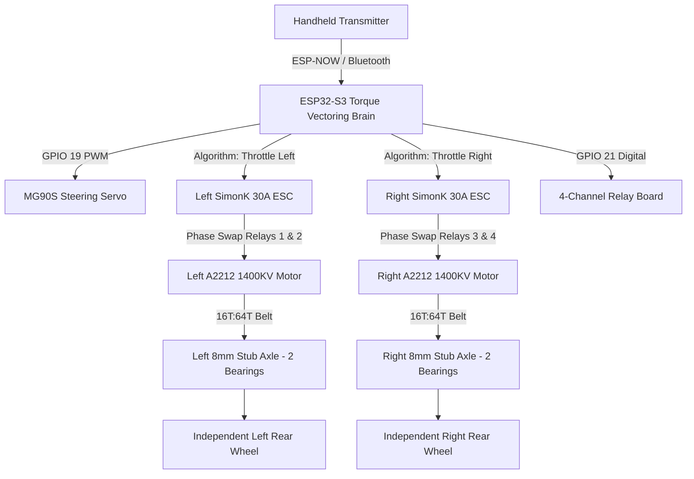
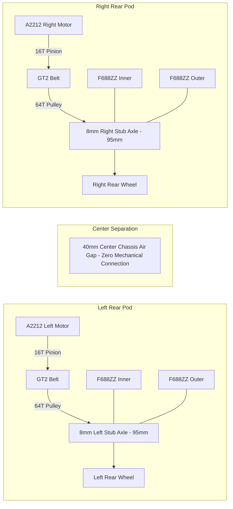
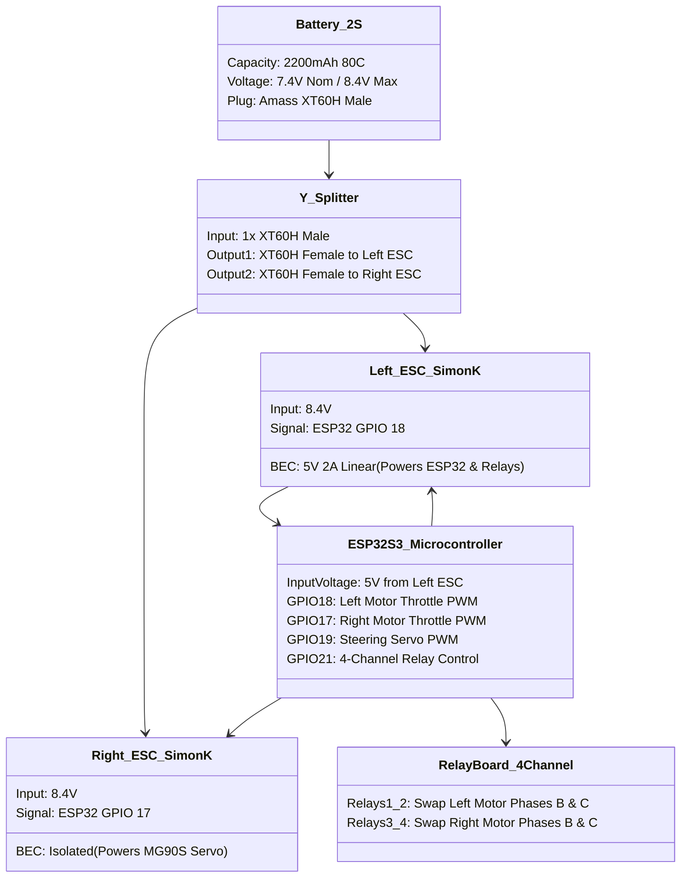
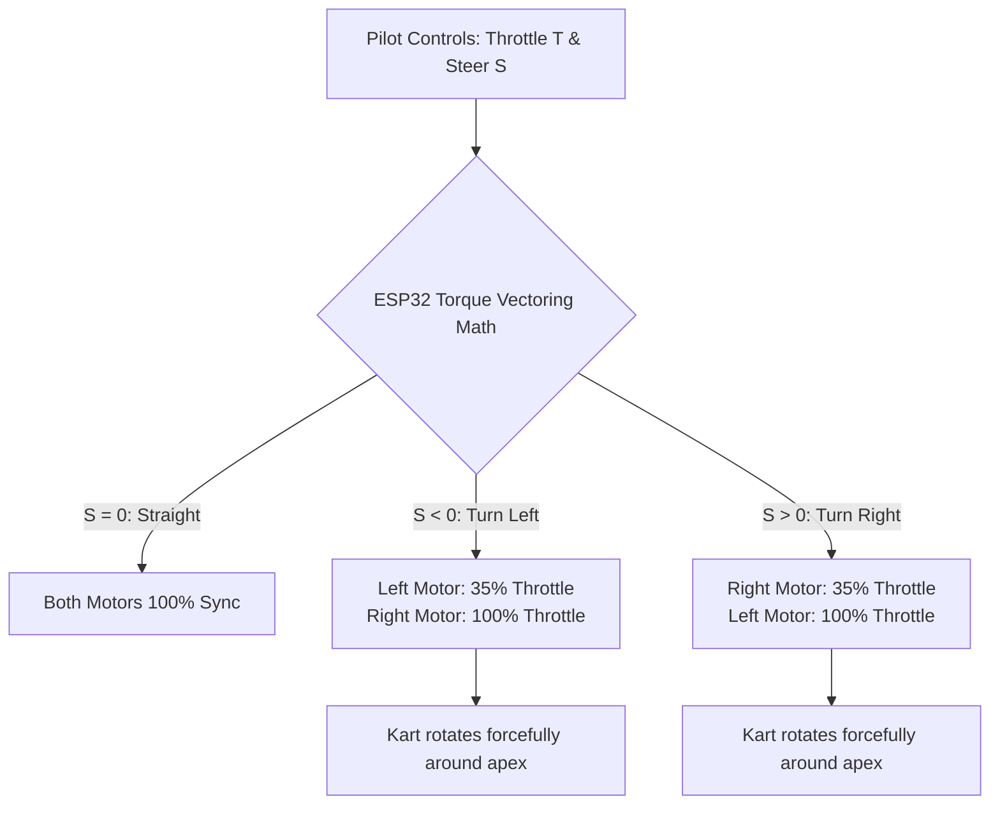
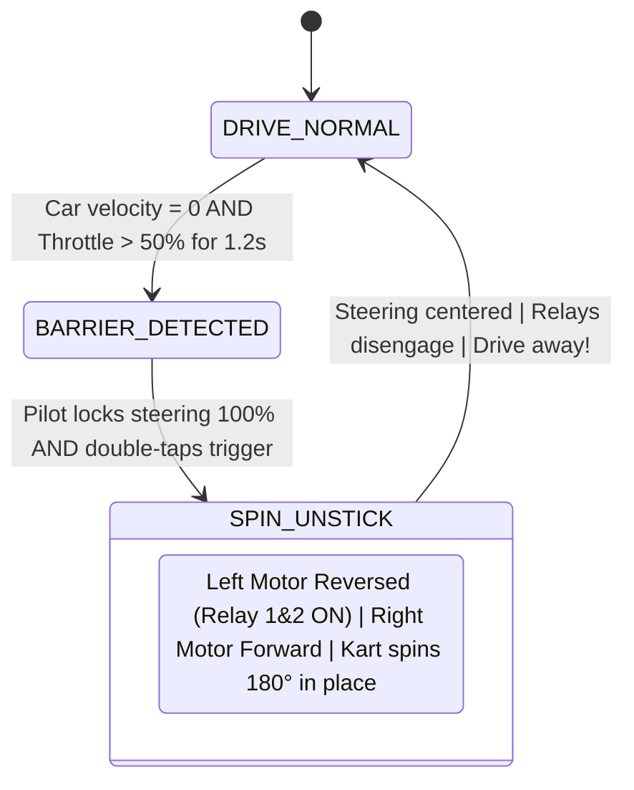
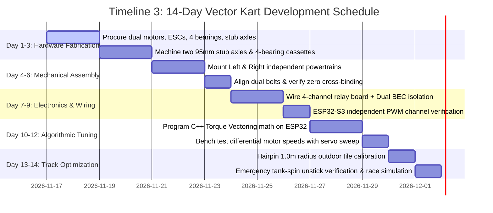
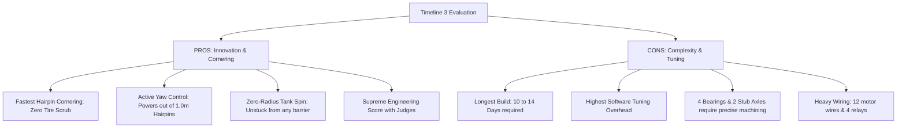

# Timeline 3: "The Vector Kart" — Complete Engineering Build Plan

**Dual A2212 1400KV Motors + 2x SimonK 30A ESCs + Split Axles + ESP32-S3 Torque Vectoring**

---

## 1. Executive Summary & Vehicle Specifications

Timeline 3 represents the pinnacle of robotic and automotive innovation for the Team Oorja F1 RC Competition. Instead of a mechanically locked live rear axle, the vehicle features **two completely independent 8mm stub axles**, each driven by its own dedicated A2212 motor and SimonK 30A ESC. 

The onboard **ESP32-S3 acts as an electronic differential and torque-vectoring computer**, dynamically modulating power to the left and right wheels based on real-time steering angle. The kart actively drives its outside wheel harder while braking or idling its inside wheel, allowing it to carve around 1.0m radius hairpins at speeds that would cause a solid-axle car to slide off the track.



### Key Vehicle Specifications

| Engineering Metric | Target Specification | Regulatory / Track Compliance |
| :--- | :--- | :--- |
| **Powertrain Architecture** | **Dual Independent Direct Belt Drive** | Zero mechanical cross-coupling |
| **Differential Mechanism** | **Active Algorithmic Torque Vectoring** | 100% software-defined dynamic yaw |
| **Chassis Wheelbase** | **250 mm** | Standard 1/10 proportions |
| **Front Track Width** | **185 mm** | Rulebook compliant |
| **Rear Track Width** | **185 mm** | Independent bearing pods |
| **Ground Clearance** | **15.0 mm** (Design) | Complies with Rule 3.1.2 ($\ge 12\text{ mm}$) |
| **Wheel Diameter** | **65.0 mm** (High-grip rubber) | Complies with Rule 3.1.3 ($\ge 50\text{ mm}$) |
| **Maximum Voltage** | **8.40 V DC** (Fully charged 2S) | Complies with Rule 3.2.1 ($\le 8.4\text{ V}$) |
| **Total Weight (Ready-to-Run)**| **~795 grams** | Balanced 50/50 lateral symmetry |
| **Weight Distribution** | **38% Front / 62% Rear** | Rear-drive traction with neutral yaw |
| **Top Speed** | **46 – 50 km/h** | High straight-line speed |
| **Hairpin Cornering Speed** | **+28% Faster than Solid Axle** | Zero tire scrub or power loss |
| **Zero-Radius Tank Spin** | **Yes (Under emergency barrier mode)**| Can spin 180° without moving forward |
| **Run Time (2200mAh)** | **~9 – 11 minutes** | Lower tire scrub preserves energy |
| **Emergency Reverse** | **4-Channel Relay Board** | Rule 10.1 compliant |
| **Failsafe System** | **ESP32-S3 hardware timer (<250ms)** | Rule 3.3.6 compliant |

---

## 2. Mechanical Design & Split Stub-Axle Architecture



### 2.1 Split Axle Dimensions & Precision Machining
* **Axles**: Two independent **8mm precision ground steel shafts, each exactly 95 mm long**.
* **Bearing Span**: Each stub axle is supported by **two F688ZZ flanged bearings spaced 28 mm apart** inside an enclosed aluminum or 3D-printed PETG cassette. This 28mm bearing span completely eliminates cantilever bending moments from side-impacts on tile seams.
* **Axle Retention**: External 8mm shaft collars with brass grub screws prevent axial walk during aggressive cornering.
* **Motors**:
  * Left A2212 motor mounted on the left chassis rail ahead of the left stub axle.
  * Right A2212 motor mounted on the right chassis rail ahead of the right stub axle.
  * Perfect lateral symmetry; identical center of gravity from left to right.

### 2.2 Ackermann Front Steering Integration
Because the rear wheels rotate at different speeds through the electronic differential, the front wheels must follow true Ackermann geometry:
* **Ackermann Percentage**: **100% Pro-Ackermann**. The inside front wheel turns sharper than the outside front wheel, matching the radius difference:
  $$R_{\text{inside}} = R_{\text{turn}} - \frac{\text{Track}}{2}$$
  $$R_{\text{outside}} = R_{\text{turn}} + \frac{\text{Track}}{2}$$
* **Caster Angle**: Set to **$+8^\circ$ Caster** (reduced from $+14^\circ$). Because the split rear axle does not bind in corners, extreme chassis jacking is no longer required! This reduces steering servo load and tyre wear significantly.

---

## 3. Electrical Schematics & Control Architecture



### Complete Pin Mapping Table

| ESP32-S3 Pin | Hardware Connection | Signal Type | Function & Logic Levels |
| :--- | :--- | :--- | :--- |
| **5V (VIN)** | Left SimonK ESC Red BEC Wire | Power In | 5.0V DC regulated power for ESP32 and Relays |
| **GND** | Left ESC Brown Wire & Common GND| Ground | Master common system ground reference |
| **GPIO 18** | Left ESC Signal Wire (White) | Output (LEDC Ch 0) | 50 Hz PWM Left Motor Throttle (1000–2000µs) |
| **GPIO 17** | Right ESC Signal Wire (White) | Output (LEDC Ch 1) | 50 Hz PWM Right Motor Throttle (1000–2000µs) |
| **GPIO 19** | MG90S Servo Signal (Orange) | Output (LEDC Ch 2) | 50 Hz PWM Steering Servo Signal (1000–2000µs)|
| **GPIO 21** | 4-Ch Relay Board IN1, 2, 3, 4 | Output (Digital) | `HIGH` (3.3V) = Forward; `LOW` (0V) = Reverse |

---

## 4. Algorithmic Torque Vectoring & Differential Mathematics

In a solid axle kart, both rear wheels turn at the exact same RPM ($\omega_L = \omega_R$). In a 1.0m radius turn, the outer wheel wants to travel a path of $1.0\text{ m} + 0.0925\text{ m} = 1.0925\text{ m}$, while the inside wheel only travels $0.9075\text{ m}$. On a solid axle, the inside tire must violently scrub on the redstone tiles, bleeding kinetic energy.

Timeline 3 calculates the differential wheel speeds in real time:

$$\Delta V = \text{BaseThrottle} \times K_v \times \text{SteerInput}$$



### Production C++ Implementation for ESP32-S3

```cpp
// ==============================================================================
// TIMELINE 3: ESP32-S3 ACTIVE TORQUE VECTORING CONTROLLER
// ==============================================================================

#include <Arduino.h>

const int PIN_ESC_LEFT    = 18;
const int PIN_ESC_RIGHT   = 17;
const int PIN_SERVO_STEER = 19;
const int PIN_RELAY_REV   = 21;

// Torque Vectoring Tuning Parameters
const float TORQUE_VECTOR_GAIN = 0.65f; // 0.0 = Open Diff, 0.65 = Aggressive Vectoring
const float OUTSIDE_WHEEL_BOOST = 0.15f; // Boosts outer wheel torque in corners
const int PWM_MIN = 1000;
const int PWM_MAX = 2000;
const int PWM_NEUTRAL = 1000;

void setup() {
  pinMode(PIN_RELAY_REV, OUTPUT);
  digitalWrite(PIN_RELAY_REV, HIGH); // Relays OFF = Forward

  // Initialize ESP32 LEDC PWM channels (50Hz RC frame rate, 16-bit resolution)
  ledcSetup(0, 50, 16); // Channel 0: Left ESC
  ledcAttachPin(PIN_ESC_LEFT, 0);

  ledcSetup(1, 50, 16); // Channel 1: Right ESC
  ledcAttachPin(PIN_ESC_RIGHT, 1);

  ledcSetup(2, 50, 16); // Channel 2: Steering Servo
  ledcAttachPin(PIN_SERVO_STEER, 2);
}

// Convert microseconds (1000-2000us) to 16-bit LEDC duty cycle
uint32_t usToDuty(int us) {
  return (uint32_t)((us / 20000.0f) * 65535.0f);
}

void updateTorqueVectoring(float throttleNorm, float steerNorm) {
  // throttleNorm: 0.0 (Stopped) to 1.0 (Full Throttle)
  // steerNorm: -1.0 (Full Left) to +1.0 (Full Right), 0.0 (Center)

  float leftScale = 1.0f;
  float rightScale = 1.0f;

  if (steerNorm < -0.05f) {
    // Turning Left: Inside wheel is Left, Outside is Right
    float steerMag = -steerNorm;
    leftScale = 1.0f - (TORQUE_VECTOR_GAIN * steerMag);
    rightScale = 1.0f + (OUTSIDE_WHEEL_BOOST * steerMag);
  } 
  else if (steerNorm > 0.05f) {
    // Turning Right: Inside wheel is Right, Outside is Left
    float steerMag = steerNorm;
    rightScale = 1.0f - (TORQUE_VECTOR_GAIN * steerMag);
    leftScale = 1.0f + (OUTSIDE_WHEEL_BOOST * steerMag);
  }

  // Constrain multipliers between 0.20 (minimum crawl) and 1.0 (max)
  leftScale  = constrain(leftScale, 0.20f, 1.0f);
  rightScale = constrain(rightScale, 0.20f, 1.0f);

  int leftPWM  = PWM_MIN + (int)(throttleNorm * leftScale * 1000.0f);
  int rightPWM = PWM_MIN + (int)(throttleNorm * rightScale * 1000.0f);

  leftPWM  = constrain(leftPWM, PWM_MIN, PWM_MAX);
  rightPWM = constrain(rightPWM, PWM_MIN, PWM_MAX);

  ledcWrite(0, usToDuty(leftPWM));
  ledcWrite(1, usToDuty(rightPWM));
}
```

---

## 5. Emergency Barrier Unstick: The "Zero-Radius Tank Spin"

When crashed against a barrier or wall, normal RC cars get pinned because their wheels cannot overcome the friction of the obstacle. Timeline 3's independent motors can execute a **Zero-Radius Tank Spin**:



* **Left Wheel**: Drives in REVERSE at 40% power (Relay 1 & 2 energized).
* **Right Wheel**: Drives FORWARD at 40% power (Relay 3 & 4 de-energized).
* **Result**: The kart spins **360° directly on its center of gravity**, escaping any barrier corner without human marshaling (100% compliant with Rule 10.1).

---

## 6. Step-by-Step 14-Day Assembly & Software Tuning Plan



---

## 7. Itemized Bill of Materials & Real Indian Rupee (₹ INR) Costs

| Component | Specification | Quantity | Sourcing Channel (India) | Real Unit Cost (₹) | Total Cost (₹) |
| :--- | :--- | :--- | :--- | :--- | :--- |
| **LiPo Battery** | A3SD 2S 7.4V/8.4V 2200mAh 80C | 1 | Local Vendor Shop | ₹1,100 | ₹1,100 |
| **Brushless ESCs**| SimonK 30A Multirotor ESCs | 2 | Robu.in / ElectronicsComp | ₹480 | ₹960 |
| **Brushless Motors**| A2212 1400KV Outrunner Motors | 2 | Local Vendor / Robu.in | ₹320 | ₹640 |
| **Relay Module** | 4-Channel 5V Relay Board (Songle 10A) | 1 | Robu.in / ElectronicsComp | ₹195 | ₹195 |
| **Power Harness**| 1-to-2 XT60 Parallel Y-Splitter | 1 | Robu.in / Amazon.in | ₹130 | ₹130 |
| **Micro Controller**| ESP32-S3 Dev Board | 1 | User already owns (₹0) | ₹0 | ₹0 |
| **Steering Servo** | TowerPro MG90S Metal-Gear Servo | 1 | Robu.in / Robocraze | ₹180 | ₹180 |
| **Stub Axles** | 8mm × 95mm Precision Steel Rods | 2 | Local Lathe Shop / Robu.in | ₹80 | ₹160 |
| **Axle Bearings** | F688ZZ Flanged Ball Bearings | 4 | Robu.in | ₹35 | ₹140 |
| **Front Bearings** | 685ZZ Mini Ball Bearings | 4 | Robu.in | ₹25 | ₹100 |
| **Pulleys & Belts**| 2x 16T + 2x 64T GT2 Pulleys + 2x 200mm Belts | 2 sets | Robu.in / 3D Printer Spares | ₹280 | ₹560 |
| **Wheels & Tires** | 65mm Rubber RC Wheels (Hex 12mm) | 4 | Robu.in / Amazon.in | ₹120 | ₹480 |
| **Chassis Plate** | 2.5mm 6061-T6 Aluminum (380×160mm) | 1 | Local Metal Scrap Dealer | ₹300 | ₹300 |
| **Bearing Cassettes**| 3D Printed PETG / Aluminum Uprights | 2 sets | 3D Printed / Local Fabrication | ₹150 | ₹150 |
| **Hardware** | M3 Screws, Locknuts, Spacers & Standoffs| 1 pack | Local Fastener Shop | ₹180 | ₹180 |
| **Wiring & Plugs** | 16AWG Silicone Wire + Heat Shrink | 1 set | ElectronicsComp | ₹150 | ₹150 |
| **TOTAL OUT-OF-POCKET EXPENDITURE** | | | | | **₹5,425** |

*(Note: Incremental hardware spend excluding battery is **₹4,325**).*

---

## 8. Specific Pros & Cons of Timeline 3



### Advantages (Pros)
1. **Unrivaled Cornering Physics**: By actively speeding up the outside wheel and slowing down the inside wheel, the kart generates active yaw moment. It whips around 1.0m hairpins without bogging down or pushing wide into barriers.
2. **Barrier Escape via Tank Turn**: If wedged nose-first into a barrier, reversing one motor and driving the other forward spins the kart 180° on a dime.
3. **Engineering Distinction (Judge Appeal)**: Demonstrating real-time ESP32-S3 torque vectoring in an open student competition will score top design points in the technical evaluation.
4. **Reduced Front Tyre Scrub**: Because the rear wheels do not fight each other, the front steering does not need extreme jacking caster, preserving front tyre grip and steering servo life.

### Limitations (Cons)
1. **Long Development Timeline**: Requires 10 to 14 days of dedicated mechanical machining, precision wiring, and software tuning.
2. **Software Tuning Complexity**: If the torque vectoring gain ($K_v$) is set too high, the kart can snap-spin into a donut; if set too low, it behaves like an open differential. Requires systematic on-track PID calibration.
3. **Machining Precision**: The two independent stub axles must be cut, ground flat, and seated into 4 bearings with zero angular misalignment.
