# Timeline 3: "The Vector Kart" — Complete Engineering Build Manual
**Configuration:** 2x A2212 1400KV Motors • 2x SimonK 30A ESCs • Split Independent Stub Axles • Proportional Ackermann Dynamic Torque Vectoring
**Estimated Build Time:** 10 – 14 Days • **Total Component Budget to Spend:** ~₹2,850 – ₹3,500

---

## 1. Executive Summary & Locked-In Architecture
Timeline 3 represents the pinnacle of innovative software-defined chassis dynamics. By replacing the locked solid axle with **two independent stub axles** and driving each rear wheel with its own dedicated motor and ESC, the ESP32-S3 acts as an **Active Electronic Differential & Torque Vectoring Controller**.

### Locked-In Specifications:
* **Powertrain:** Dual independent A2212 1400KV motors driving separate Left and Right stub axles (zero mechanical connection between rear wheels).
* **Rear Axle Setup:** Two independent 8mm ground steel stub axles (~95mm length each) running in **4x F688ZZ flanged ball bearings** (2 bearings per side in isolated bearing cassettes).
* **Torque Vectoring Algorithm:** Proportional Ackermann Speed Differential. The ESP32 calculates individual motor PWM values in real time based on steering angle:
  $$\text{Throttle}_{\text{Outer}} = \text{Base} \times (1.0 + 0.35 \times |\text{Steer}|)$$
  $$\text{Throttle}_{\text{Inner}} = \text{Base} \times (1.0 - 0.70 \times |\text{Steer}|)$$
* **Cornering Dynamics:** Eliminates the need for dynamic chassis jacking or lifting the inside tire! The inside wheel slows down while the outside wheel accelerates, literally rotating the kart around the 1.0m hairpin apex like a compass with zero tire drag.
* **Chassis Platform:** 2.5mm Aluminum Pan with twin independent rear bearing pods and center battery trough.
* **Ground Clearance:** 15.0mm static ride height with 30° rockered ski-ramp front bumper for 2–5mm tile seam clearance.
* **Controller Interface:** Dual-compatible ESP32-S3 firmware supporting Bluetooth Gamepad (PS4/Xbox via Bluepad32) and ESP-NOW handheld remote.

---

## 2. Complete Bill of Materials (BOM) & Budget (in ₹ INR)

| Item # | Component Description | Source / Notes | Qty | Est. Cost (₹ INR) | Status |
| :---: | :--- | :--- | :---: | :---: | :---: |
| 1 | **ESP32-S3 Development Board** | On hand | 1 | ₹0 (Owned) | ✅ In hand |
| 2 | **A2212 1400KV Brushless Motors** | Local vendor / Robu.in | 2 | ₹700 – ₹840 | 🛒 To procure |
| 3 | **SimonK 30A Brushless ESCs** | Local vendor / Robu.in | 2 | ₹600 – ₹750 | 🛒 To procure |
| 4 | **A3SD 2S 2200mAh 80C LiPo** | Local vendor (XT60) | 1 | ₹750 – ₹900 | 🛒 To procure |
| 5 | **4-Channel 5V Relay Module** | Local electronics shop | 1 | ₹180 – ₹240 | 🛒 To procure |
| 6 | **MG90S Metal Gear Micro Servo** | Local hobby vendor | 1 | ₹180 – ₹220 | 🛒 To procure |
| 7 | **8mm Ground Steel Rods (2x 95mm stubs)** | Cut from single 250mm rod | 2 | ₹120 – ₹160 | 🛒 To procure |
| 8 | **F688ZZ Flanged Ball Bearings** | 3D printer parts supplier (2 per side) | 4 | ₹160 – ₹200 | 🛒 To procure |
| 9 | **623ZZ Ball Bearings (Idler Snubbers)** | 3D printer parts supplier | 2 | ₹30 – ₹50 | 🛒 To procure |
| 10 | **GT2 16T Motor Pulleys (3.17mm bore)** | 3D printer parts supplier | 2 | ₹120 – ₹160 | 🛒 To procure |
| 11 | **GT2 Closed Belts (6mm wide, ~200mm)** | 3D printer parts supplier | 2 | ₹140 – ₹180 | 🛒 To procure |
| 12 | **XT60 Y-Splitter Harness** | Hobby shop / DIY solder | 1 | ₹80 – ₹120 | 🛒 To procure |
| 13 | **2.5mm Aluminum Sheet (360x220mm)** | Local metal fabricator | 1 | ₹350 – ₹500 | 🛒 To procure |
| 14 | **65mm RC Touring Rubber Slick Wheels** | Local vendor / Robu.in | 4 | ₹400 – ₹550 | 🛒 To procure |
| 15 | **Hardware & Fasteners (M3, M4)** | Hardware shop | Assorted | ₹120 – ₹160 | 🛒 To procure |
| 16 | **3D Printed PETG Parts (Filament)** | Self-printed (~380g) | 1 | ₹380 | 🖨️ To print |
| **TOTAL**| **Estimated Total Spend for Timeline 3** | | | **₹4,490 – ₹5,630** *(or ~₹3,150 excluding battery/wheels if already budgeted)* | |

---

## 3. Step-by-Step 12-Day Execution Roadmap

```mermaid
gantt
    title Timeline 3: 12-Day Build Schedule
    dateFormat  D
    axisFormat Day %d
    section Day 1-3: Split Axle Mechanicals
    Cut 2x 95mm Stub Axles from 8mm Steel Rod :done, t3_1, 1, 1d
    File 10mm D-Cuts on both Outer Ends & Assemble 12mm Hexes :t3_2, after t3_1, 1d
    Fabricate Left & Right Bearing Cassettes (4x F688ZZ Bearings) :t3_3, after t3_2, 1d
    section Day 4-6: Independent Drivetrain
    Mount Left A2212 -> Left 16T:64T Belt -> Left Stub Axle :t3_4, after t3_3, 1d
    Mount Right A2212 -> Right 16T:64T Belt -> Right Stub Axle :t3_5, after t3_4, 1d
    Wire Dual ESC Signal Lines to ESP32 GPIO 17 & 18 :t3_6, after t3_5, 1d
    section Day 7-9: Torque Vectoring Firmware
    Code C++ Proportional Ackermann Steering-Throttle Mix :t3_7, after t3_6, 2d
    Implement Dual-Motor Barrier Unstick State Machine :t3_8, after t3_7, 1d
    section Day 10-12: Calibration & Track Testing
    Zero-Scrub Hairpin Turning Radius Calibration on Tiles :t3_9, after t3_8, 2d
    Full 8-Lap Endurance, High-Speed Straight Stability & Thermals :t3_10, after t3_9, 1d
```



---

## 4. ESP32-S3 Torque Vectoring C++ Algorithm Architecture

In `firmware/vector_kart_controller.ino`, the steering angle directly computes individual microsecond PWM values for the Left and Right ESCs:

```cpp
// Proportional Ackermann Differential Function
void calculateTorqueVectoring(int baseThrottle, int steerInput, int &leftPWM, int &rightPWM) {
    // steerInput ranges from -100 (Full Left) to +100 (Full Right)
    // baseThrottle ranges from 0 to 100
    
    float steerFactor = steerInput / 100.0f; // -1.0 to +1.0
    float leftScale  = 1.0f;
    float rightScale = 1.0f;

    if (steerFactor > 0.05f) {
        // TURNING RIGHT: Right wheel is inside (slows down), Left wheel is outside (speeds up)
        rightScale = 1.0f - (0.70f * steerFactor);
        leftScale  = 1.0f + (0.35f * steerFactor);
    } 
    else if (steerFactor < -0.05f) {
        // TURNING LEFT: Left wheel is inside (slows down), Right wheel is outside (speeds up)
        leftScale  = 1.0f - (0.70f * fabsf(steerFactor));
        rightScale = 1.0f + (0.35f * fabsf(steerFactor));
    }

    // Clamp scaling limits
    leftScale  = constrain(leftScale,  0.20f, 1.40f);
    rightScale = constrain(rightScale, 0.20f, 1.40f);

    int targetLeftThrot  = (int)(baseThrottle * leftScale);
    int targetRightThrot = (int)(baseThrottle * rightScale);

    targetLeftThrot  = constrain(targetLeftThrot,  0, 100);
    targetRightThrot = constrain(targetRightThrot, 0, 100);

    // Map to standard ESC PWM microsecond pulses
    leftPWM  = map(targetLeftThrot,  0, 100, 1000, 2000);
    rightPWM = map(targetRightThrot, 0, 100, 1000, 2000);
}
```

### Dynamic Cornering Advantages:
1. **Zero Tire Scrub**: Unlike a locked solid axle which must lift the inside tire to turn without dragging, each wheel rotates at its mathematically exact geometric speed around any radius down to 0.8 meters!
2. **Instant Apex Rotation**: Because the outside wheel is powered harder, a yaw torque moment is actively generated about the vehicle's vertical axis, pulling the front nose sharply into the turn without demanding extreme tire grip from the front tires alone.
3. **True Differential in Reverse**: During barrier recovery, the independent motors can reverse independently, allowing the kart to rotate away from a wall collision even while backing up!
